# ORKIN · Cotizador Web — Estructura de la base de datos

> **Motor:** SQL Server 2022+ (Developer Edition en desarrollo).
> **Runtime:** .NET 10 (`net10.0`) · EF Core 10.0.12 · `Microsoft.EntityFrameworkCore.SqlServer`.
> **ORM:** EF Core 10 · Code First + migraciones (`dotnet ef`), nunca `EnsureCreated`.
> **Estado:** 🔵 En revisión — pendiente de validación del cliente.
> **Fecha:** 2026-09-27

Este documento es la **especificación de la base de datos**. El código de las entidades y del
`DbContext` se generará a partir de aquí (tarea 0.4 y 0.7 del README).

---

## 1. Alcance

Cubre todo lo que necesita el **módulo Cotizador** más los cimientos que el cliente pidió desde el
arranque:

| Área | ¿En este documento? | Nota |
|---|---|---|
| Seguridad propia (usuarios, roles, permisos, sesiones, tokens) | ✅ Sí | Esquema `seg`. Decisión D-02 |
| Catálogos de costeo (productos, activos, unidades, tipos de servicio, tipo de cambio) | ✅ Sí | Vienen del Excel |
| Cotización y sus detalles (la factura del cotizador) | ✅ Sí | Con **snapshots** de todo lo calculado |
| Aprobación por token público (enlace sin login) | ✅ Sí | Tabla `dbo.CotizacionAprobacion` |
| Auditoría append-only | ✅ Sí | Esquema `aud` |
| Consecutivos y parámetros configurables | ✅ Sí | |
| **Costura para integración con ERP** | ✅ Sí | Esquema `int`. Ver §7 |
| Módulos futuros (calendario, órdenes, facturación) | ❌ No | Se agregan en Fase 11, encima de estas tablas |
| App móvil / MAUI | ❌ No | Fuera de alcance (D-13) |

---

## 2. Decisiones de diseño que afectan al modelo

| # | Decisión | Por qué |
|---|---|---|
| 1 | **4 esquemas:** `dbo`, `seg`, `int`, `aud` | Permite respaldar el ERP y la auditoría por separado, y saber de un vistazo de dónde viene cada tabla. |
| 2 | **Dinero en `decimal(18,6)` sin redondeo intermedio** | El Excel guarda precios como `9.999444` y `415.261225`. Si redondeamos a 2 decimales los totals se desvían del Excel y se rompen los *golden master*. El redondeo a 2 decimales ocurre **solo al presentar** (PDF, UI, correo). |
| 3 | **Margen como fracción en `decimal(5,4)`** con `CHECK` `>= 0 AND <= 1` | El Excel confunde `0%` con fracción: el usuario escribe `5,5%` y la celda guarda `5.5` (550 %). Almacenar la fracción hace imposible el error (**H-02**). |
| 4 | **Toda cotización guarda un snapshot de lo que usó para calcular** | Si mañana sube el precio de un producto o cambia el tipo de cambio, una cotización ya emitida **no debe cambiar**. Por eso los detalles guardan el precio unitario, la vida útil y el tipo de cambio tal como estaban. |
| 5 | **Enums como `tinyint` + tabla de catálogo** | Legible en SQL, integridad referencial real, y la etiqueta vive en la base (no en el código) para poder cambiarla sin desplegar. |
| 6 | **La cotización nunca se borra; se anula** | Requisito de trazabilidad. Las tablas de detalle se conservan tal cual. |
| 7 | **Identidad en cliente (`Guid.NewGuid()`)** | Coherente con la referencia del proyecto. `Cotizacion` y `Cliente` son las entidades donde importa (evita colonies en índices). |
| 8 | **Preparación para ERP desde el día 1** | Toda fila de catálogo tiene `OrigenDato`, `CodigoExterno` y `HashContenido`. Añadir la sincronización después es solo escribir el conector; no hay que migrar 1 500 filas. Ver §7. |
| 9 | **Fechas de negocio en `date`, marcas de tiempo en `datetime2(3)` UTC** | Evita el desfase de 6 horas de Nicaragua en los cálculos de "hoy". El `date` no lleva hora: correcto para fecha de cotización y fecha de tipo de cambio. |
| 10 | **Collation `SQL_Latin1_General_CP1_CI_AS`** | Buscar `"RATONES"` debe encontrar `"Ratón"` y viceversa. Sin tildes ni mayúsculas en la base. |

---

## 3. Convenciones

| Tema | Convención |
|---|---|
| Nombres de tabla y columna | `PascalCase`, **singular**, sin tildes ni eñes: `Cotizacion`, `DetalleInsumo`, `PrecioUnitario` |
| Claves primarias | `Id uniqueidentifier NOT NULL` con `DEFAULT NEWSEQUENTIALID()` |
| FKs | `Id` + el nombre de la entidad: `CotizacionId`, `ProductoId` |
| FKs obligatorias | `NOT NULL`. Navegación en C#: `= null!` |
| FKs opcionales | `NULL`. Navegación en C#: `?` |
| Dinero | `decimal(18,6)` |
| Cantidades | `decimal(18,4)` (admiten fracciones: ml, gr, H.H, km) |
| Porcentajes / tasas | `decimal(9,6)` |
| Margen (fracción) | `decimal(5,4)` |
| Tipo de cambio | `decimal(18,6)` |
| Booleans | `bit` con `DEFAULT` explícito siempre |
| Enums | `tinyint` con FK a la tabla de catálogo correspondiente |
| Fechas de negocio | `date` |
| Marcas de tiempo | `datetime2(3)`, **siempre UTC** |
| Texto corto | `nvarchar(n)` — **nunca** `varchar` (acentos y ñ) |
| Texto largo / JSON | `nvarchar(max)` |
| Hipervínculos / correos | `nvarchar(256)` (o `450` para URL larga) |
| IP | `nvarchar(45)` (soporta IPv6) |
| Hash SHA-256 | `binary(32)` |
| Concurrencia optimista | `rowversion` en tablas editables |
| Índices | `IX_<Tabla>_<Columnas>` y `UX_<Tabla>_<Columnas>` |
| Auditoría | Las 4 columnas base de §3.1 en toda tabla de negocio |

### 3.1 Columnas base de auditoría

Presentes en **todas** las tablas de `dbo`, `seg` e `int` (excepto las de solo lectura y las
append-only de `aud`):

| Columna | Tipo | Null | Default | Nota |
|---|---|---|---|---|
| `CreatedAt` | `datetime2(3)` | No | `SYSUTCDATETIME()` | UTC |
| `CreatedBy` | `uniqueidentifier` | Sí | `NULL` | FK a `seg.Usuario` |
| `UpdatedAt` | `datetime2(3)` | No | `SYSUTCDATETIME()` | Actualizado por un `SaveChangesInterceptor` |
| `UpdatedBy` | `uniqueidentifier` | Sí | `NULL` | FK a `seg.Usuario` |
| `IsActive` | `bit` | No | `1` | Baja lógica. **Solo** en catálogos y maestros. Las cotizaciones se **anulan**. |
| `RowVersion` | `rowversion` | No | — | Concurrencia optimista (`SqlServer` lo gestiona solo) |

> Las tablas de `aud` (§9) **no** llevan estas columnas: son append-only y autogestionadas.

---

## 4. Diagrama de entidades

```mermaid
erDiagram
    Usuario ||--o{ Rol : "usuario_rol"
    Rol ||--o{ Permiso : "rol_permiso"
    Usuario ||--o{ UsuarioRol : ""
    Rol ||--o{ UsuarioRol : ""
    Usuario ||--o{ UsuarioPermiso : "directo"
    Usuario ||--o{ RefreshToken : ""
    Usuario ||--o{ Sesion : ""

    Cliente ||--o{ Cotizacion : ""
    TipoServicio ||--o{ Cotizacion : ""
    TipoServicio ||--o{ TipoServicioMargen : ""
    Cotizacion ||--o{ DetalleInsumo : ""
    Producto ||--o{ DetalleInsumo : ""
    Cotizacion ||--o{ DetalleAmortizable : ""
    ActivoAmortizable ||--o{ DetalleAmortizable : ""
    Cotizacion ||--o{ CotizacionAprobacion : ""
    Cotizacion ||--o{ Cotizacion : "versiones"
    Cotizacion ||--o{ DocumentoGenerado : ""
    Cotizacion ||--o{ NotificacionEnviada : ""
    Cotizacion }o--|| TipoCambio : ""
    Producto ||--o{ PrecioProducto : ""
    Producto }o--|| UnidadMedida : ""
    Producto }o--o| CategoriaProducto : ""
    ActivoAmortizable ||--o{ PrecioActivo : ""
    ActivoAmortizable }o--|| UnidadMedida : ""

    ErpConexion ||--o{ ErpFlujo : "define"
    ErpFlujo ||--o{ ErpOrigen : ""
    ErpFlujo ||--o{ ErpDestino : ""
    ErpFlujo ||--o{ ErpMapeoCampo : ""
    ErpFlujo ||--o{ ErpValidacion : ""
    ErpFlujo ||--o{ SincronizacionEjecucion : ""
    ErpFlujo ||--o{ ErpRechazo : ""
    ErpFlujo ||--o{ ErpSimulacion : ""
    ErpFlujo ||--o{ ErpAlerta : ""
    ErpFlujo ||--o{ ErpDependencia : "antes"
    ErpConexion ||--o{ EventoRecibido : ""
    ErpConexion ||--o{ Producto : "origen"
    ErpConexion ||--o{ Cliente : "origen"
```



---

## 5. Catálogos de dominio (`dbo.*Catalogo`)

**Regla dura (ADR-018): en el código no hay catálogos.** Ningún `enum` de C# define un conjunto de
valores de negocio, y ninguna lista de valores por defecto está escrita en C#. El conjunto, la
etiqueta y el orden viven **solo aquí**. El código se refiere a un valor por su `Codigo` —una clave
estable **en texto**, no un ordinal— y resuelve el `Id` consultando la tabla al arrancar. Por eso la
UI y el PDF no llevan textos hardcodeados, y renombrar "EnAprobacion" a "En revisión" en la base no
rompe nada.

La lógica de negocio, en cambio, **sí** vive en el código (`Core.Domain`): las fórmulas del motor y
las reglas RN-01 a RN-10. Lo que se mueve a la base es el *conjunto* de opciones y *qué* opción
aplica a cada caso, nunca *cómo* se calcula.

### 5.0 Forma común de las tablas catálogo

| Columna | Tipo | Null | Default | Notas |
|---|---|---|---|---|
| `Id` | `tinyint IDENTITY` | No | — | PK. **Lo asigna la BD**; el código nunca lo fija |
| `Codigo` | `nvarchar(30)` | No | — | `UX`. Clave estable con la que el código se refiere al valor. Ej. `RESIDENCIAL` |
| `Nombre` | `nvarchar(100)` | No | — | Etiqueta que ve el usuario |
| `Descripcion` | `nvarchar(300)` | Sí | `NULL` | |
| `Orden` | `tinyint` | No | `0` | Orden de presentación |
| `EsActivo` | `bit` | No | `1` | |
| `EsSembrado` | `bit` | No | `1` | `1` = la fila viene del seed (§5.20). `0` = la creó un usuario |

Estas tablas **no** llevan las columnas base de §3.1 ni `rowversion`: son de solo lectura en runtime
y una fila de catálogo no "se actualiza", se sustituye.

**Cómo las consulta el código.** Un `ICatalogoResolver` (capa de aplicación) resuelve
`Codigo → Id` una vez al arrancar y lo cachea:

```csharp
// Sin un solo literal de valor de negocio. "RESIDENCIAL" es la clave de contrato
// con la base, no una copia del dato: en la base, el Id lo asigna IDENTITY y la
// etiqueta la edita quien quiera.
byte id = await catalogo.ResolverIdAsync("RESIDENCIAL", cancellationToken);
```

La caché se invalida si `ICatalogoService` expone una operación de recarga, para que agregar un
valor desde Administración no exija reiniciar.

**Y los `CHECK`.** Un `CHECK` de SQL Server no admite subconsultas, así que no puede comparar
contra el catálogo con un `IN`. Cuando una regla dependa de *qué* valores del catálogo son
"especiales", la respuesta es una columna de bandera en el catálogo (por ejemplo
`EsEstadoFinal` en §5.7) más una función escalar que la lea:

```sql
-- El conjunto de estados finales es DATO (la columna del catálogo).
-- La regla "si está resuelta, la fecha es obligatoria" es LÓGICA (el CHECK).
CHECK (dbo.FnEsEstadoFinalAprobacion(Estado) = 0 OR FechaRespuesta IS NOT NULL)
```

Así ni el `CHECK` ni el código llevan dentro el número `3` de "rechazada".

### 5.1 `dbo.TipoClienteCatalogo` — segmento del cliente

| Codigo | Nombre | `MetodoCosteoId` | Regla de negocio |
|---|---|---|---|
| `RESIDENCIAL` | Residencial | `SUMA_SIMPLE` | Costeo por suma simple (RN-04) |
| `EMPRESARIAL` | Empresarial | `PROMEDIO_SEMESTRES` | Costeo por promedio de semestres (RN-07) |

Además de las columnas de §5.0:

| Columna | Tipo | Null | Notas |
|---|---|---|---|
| `MetodoCosteoId` | `tinyint` | No | FK → `dbo.MetodoCosteoCatalogo`. **Qué** método se aplica (dato) |
| `EsPredeterminado` | `bit` | No | `1` = el segmento que se sugiere al crear un cliente |

> ⚠️ La columna dice **qué** método usar. La fórmula del método vive en el código
> (`Core.Domain/MotorCalculo`), no aquí: eso es lógica de negocio.

### 5.2 `dbo.EstadoCotizacionCatalogo` — Badges del Prototipo D

| Codigo | Nombre | Transiciones permitidas |
|---|---|---|
| `BORRADOR` | Borrador | → `EN_APROBACION`, `ANULADA` |
| `EN_APROBACION` | En aprobación | → `APROBADA`, `RECHAZADA`, `VENCIDA`, `BORRADOR`, `ANULADA` |
| `APROBADA` | Aprobada | → `ENVIADA`, `ANULADA`, `VENCIDA` |
| `RECHAZADA` | Rechazada | → `BORRADOR`, `ANULADA` |
| `ENVIADA` | Enviada | → `VENCIDA`, `ANULADA`, `APROBADA` |
| `VENCIDA` | Vencida | → `EN_APROBACION`, `ANULADA` |
| `ANULADA` | Anulada | → (terminal) |
| `CONVERTIDA_EN_SERVICIO` | Convertida en servicio | → (terminal) |

> Las **transiciones permitidas** son el comportamiento de la máquina de estados. Se validan en el
> código (`EstadoCotizacionService`), no con literales dispersos.

### 5.3 `dbo.SemestreCatalogo`

| Codigo | Nombre | Orden |
|---|---|---|
| `PRIMERO` | Primer semestre | 1 |
| `SEGUNDO` | Segundo semestre | 2 |

> En `dbo.DetalleInsumo` el semestre es **opcional**: `NULL` = indistinto (caso residencial, RN-04).

### 5.4 `dbo.ModalidadCatalogo`

| Codigo | Nombre | Predeterminado |
|---|---|---|
| `EVENTUAL` | Eventual (una sola visita) | |
| `MENSUAL` | Mensual | ✅ |
| `BIMESTRAL` | Bimestral | |
| `TRIMESTRAL` | Trimestral | |
| `SEMESTRAL` | Semestral | |
| `ANUAL` | Anual | |

> `dbo.Cotizacion.Modalidad` es `NOT NULL` **sin** `DEFAULT` de SQL: el valor lo resuelve el servicio
> leyendo la fila con `EsActivo = 1` y el orden de la siembra. Nada de `DEFAULT 1` a ciegas.

### 5.5 `dbo.OrigenDatoCatalogo` — de dónde viene un dato maestro

| Codigo | Nombre |
|---|---|
| `MANUAL` | Capturado en la web |
| `EXCEL` | Importación inicial desde el cotizador en Excel |
| `ERP` | Sincronizado desde un ERP |
| `SISTEMA` | Derivado por el sistema (p. ej. tipo de cambio del Banco Central) |

> Es lo que permite, en la Fase 12, que el ERP cargue catálogos sin cambiar el modelo de datos
> (ADR-013) y separar "dato inicial del Excel" de "dato queleased" de "lo que corrigió un usuario".

### 5.6 `dbo.FuenteTipoCambioCatalogo`

| Codigo | Nombre |
|---|---|
| `MANUAL` | Carga manual |
| `BANCO_CENTRAL` | Banco Central de Nicaragua |
| `API_EXTERNA` | API externa configurable |

### 5.7 `dbo.EstadoAprobacionCatalogo`

| Codigo | Nombre | `EsEstadoFinal` |
|---|---|---|
| `PENDIENTE` | Pendiente | |
| `APROBADA` | Aprobada | ✅ |
| `RECHAZADA` | Rechazada | ✅ |
| `VENCIDA` | Vencida | ✅ |
| `CANCELADA` | Cancelada | ✅ |

> Columna propia de este catálogo, además de las de §5.0. Define **qué** estados son una
> resolución de la aprobación, para que el `CHECK` de §6.11 no tenga que llevar el número de
> "rechazada" escrito dentro (ver §5.0).

### 5.8 `dbo.OrigenPrecioCatalogo`

| Codigo | Nombre |
|---|---|
| `MANUAL` | Manual |
| `EXCEL` | Importación inicial desde el Excel |
| `ERP` | ERP |

> Distingue "cargado del Excel en la importación" de "cargado a mano". Permite saber cuánto del dato
> inicial sobrevivió a la corrección de duplicados (H-10).

### 5.9 `dbo.TipoNotificacionCatalogo`

| Codigo | Nombre | Destinatario |
|---|---|---|
| `COTIZACION_ENVIADA` | Cotización enviada al cliente | Cliente |
| `SOLICITUD_APROBACION` | Solicitud de aprobación | Aprobador (interno) |
| `APROBACION_CONCEDIDA` | Aprobación concedida | Cliente |
| `COTIZACION_RECHAZADA` | Cotización rechazada | Vendedor |
| `COTIZACION_ANULADA` | Cotización anulada | Cliente + interno |

### 5.10 `dbo.EstadoNotificacionCatalogo`

| Codigo | Nombre |
|---|---|
| `PENDIENTE` | Pendiente |
| `ENVIADA` | Enviada |
| `FALLIDA` | Fallida |
| `DESCARTADA` | Descartada |

### 5.11 `dbo.TipoDocumentoCatalogo`

| Codigo | Nombre |
|---|---|
| `PDF_COTIZACION` | Cotización (PDF) |
| `COMPROBANTE_APROBACION` | Comprobante de aprobación |

### 5.12 `dbo.MetodoCosteoCatalogo` — cómo se costea una cotización

> **Nuevo (ADR-018).** Separa *qué* métodos existen (dato, aquí) de *cómo* se calcula cada uno
> (lógica de negocio, en `Core.Domain/MotorCalculo`).

| Codigo | Nombre | Notas |
|---|---|---|
| `SUMA_SIMPLE` | Suma simple | RN-04: `Σinsumos + ΣvalorMensual`, más la plantilla del residencial |
| `PROMEDIO_SEMESTRES` | Promedio de semestres | RN-07: `AVERAGE(Σsem1, Σsem2) + ΣvalorMensual` |

Al arrancar, la capa de infraestructura lee esta tabla y construye el value object
`MetodoCosteo` con los `Id` resueltos, que se inyecta en el motor. **El motor no contiene ningún
número mágico**: si mañana aparece un tercer método, se agrega la fila aquí y la rama de cálculo en
el código, sin tocar la siembra de los demás catálogos.

### 5.13 `dbo.AccionAuditoriaCatalogo`

> **Nuevo (ADR-018).** Lo que se registra en `aud.RegistroAuditoria` es un conjunto cerrado, y
> §9.1 lo tenía escrito como doce números dentro del esquema.

| Codigo | Nombre |
|---|---|
| `CREADO` | Creado |
| `ACTUALIZADO` | Actualizado |
| `ELIMINADO` | Eliminado |
| `ANULADO` | Anulado |
| `APROBADO` | Aprobado |
| `RECHAZADO` | Rechazado |
| `RESTAURADO` | Restaurado |
| `LOGIN` | Inicio de sesión |
| `LOGOUT` | Cierre de sesión |
| `ACCESO_DENEGADO` | Acceso denegado |
| `EXPORTADO` | Exportado |
| `SINCRONIZADO` | Sincronizado |

> Fíjate en que `APROBAR` y `RECHAZAR` de la aplicación **no** son lo mismo que `APROBADO` y
> `RECHAZADO` de la bitácora: uno es la intención del usuario y el otro, el hecho registrado. Por eso
> son códigos distintos y no una lista de "acciones de la aplicación".

### 5.14 `dbo.TipoDatoParametroCatalogo`

> **Nuevo (ADR-018).** `dbo.ParametroGeneral.TipoDato` decide cómo se convierte el texto del
> parámetro. Si el conjunto viviera en el código, alguien agregaría un tipo y se olvidaría de la
> conversión.

| Codigo | Nombre | Cómo se convierte el `Valor` |
|---|---|---|
| `TEXTO` | Texto | tal cual |
| `ENTERO` | Entero | `int.TryParse` |
| `DECIMAL` | Decimal | `decimal.TryParse` con la cultura del ambiente |
| `LOGICO` | Lógico | `bool.TryParse` + `1/0/si/no/verdadero/falso` |
| `FECHA` | Fecha | `DateOnly.TryParse` |
| `JSON` | JSON | `JsonDocument.Parse` (valida que sea JSON bien formado) |

### 5.15 `dbo.TipoConsecutivoCatalogo` — qué numeraciones oficiales existen

> **Nuevo (ADR-018).** `dbo.Consecutivo.Entidad` guardaba un `nvarchar` con valores escritos a
> mano en el código. Agregar una numeración oficial obligaba a tocar el `CHECK` y el formateador.

| Codigo | Nombre | `Plantilla` | `Prefijo` | `Sufijo` | `Digitos` | `ReiniciaPorAnio` | Nota |
|---|---|---|---|---|---|---|---|
| `COTIZACION` | Cotización | `{PRE}{ANIO}-{NUM}` | `COT-` | `""` | 4 | `1` | `COT-2026-0413`. Depende de **D-17** (numeración oficial) |

El **formato del número vive aquí y no en un formateador de C#**. La `Plantilla` es texto libre
con las secciones `{PRE}`, `{ANIO}`, `{NUM}` y `{SUF}` en el orden que corresponda; todo lo que no
es una sección se copia tal cual, así que el guion va donde lo ponga el dato y no el código. Cada
sección puede aparecer a lo sumo una vez y `{NUM}` es obligatoria (sin ella el número no
incrementa: sería una constante con otro nombre). `Prefijo` y `Sufijo` son el texto que expanden
`{PRE}` y `{SUF}`; `Digitos` son los ceros a la izquierda de `{NUM}` (1 a 19, el ancho de un
`bigint`, que es el tipo real del contador). Si la plantilla lleva `{ANIO}`, `ReiniciaPorAnio`
tiene que ser `1`: un número con año en un contador que no reinicia mezclaría años y no se podría
saber si `2026-41` va antes o después de `2026-5`.

**El `CHECK` que protege la plantilla vive en la base** — `CK_TipoConsecutivoCatalogo_PlantillaValida`
usa la función escalar `dbo.FnPlantillaConsecutivoValida(Plantilla, ReiniciaPorAnio, Digitos)`,
escrita a mano en la migración como `dbo.FnEsEstadoFinalAprobacion`. El CHECK valida las secciones,
el `{NUM}` obligatorio, la no repetición y la pareja `{ANIO}`/`ReiniciaPorAnio` en cada INSERT y
UPDATE.

**Solo se numera lo que la plataforma crea.** `CLIENTE`, `PRODUCTO` y `ACTIVO` ya **no** están acá:
sus códigos los genera la transformación desde el ERP y renumerarlos rompería el enlace con el
identificador que les puso el origen. Agregar una numeración oficial de la plataforma es una fila
más, no un `switch`.

### 5.16 `dbo.ModuloPermisoCatalogo` — agrupación de permisos

> **Nuevo (ADR-018).** `seg.Permiso.Modulo` y el `switch` que armaba la pantalla de roles.

| Codigo | Nombre | Orden |
|---|---|---|
| `DASHBOARD` | Dashboard | 1 |
| `COTIZACIONES` | Cotizaciones | 2 |
| `CLIENTES` | Clientes | 3 |
| `CATALOGOS` | Catálogos | 4 |
| `APROBACIONES` | Aprobaciones | 5 |
| `ADMIN` | Administración | 6 |
| `AUDITORIA` | Auditoría | 7 |

El código del permiso se arma como `Modulo + "." + Accion`, o sea `COTIZACIONES.CREAR`. Ese
`"."` es un separador, no un dato: vive en un parámetro (`SEG.PERMITIDO_SEPARADOR`) por si algún
día hay que cambiarlo.

### 5.17 `dbo.NivelAccesoCatalogo` — alcance de un rol

> **Nuevo (ADR-018).** Oculta menús y acota la vista de datos.

| Codigo | Nombre | Alcance |
|---|---|---|
| `OPERATIVO` | Operativo | Solo lo asignado |
| `SUPERVISOR` | Supervisor | Todo lo de su sucursal |
| `ADMINISTRADOR` | Administrador | Todo |

### 5.18 `dbo.OrigenMargenCatalogo` — de dónde salió el margen aplicado

> **Nuevo (ADR-018).** `dbo.Cotizacion.MargenOrigen`: hoy no se sabe si el 5.5 % lo tecleó una
> persona o vino del catálogo, y eso es justo lo que hay que auditar.

| Codigo | Nombre |
|---|---|
| `MANUAL` | Tecleado en la cotización |
| `SUGERIDO_TIPO_SERVICIO` | Sugerido por `dbo.TipoServicioMargen` |
| `PARAMETRO` | Tomado de `dbo.ParametroGeneral` |

### 5.19 `dbo.NivelAprobacionCatalogo` — por qué se pidió aprobación

> **Nuevo (ADR-018).** `dbo.CotizacionAprobacion.Nivel` (depende de **D-05**).

| Codigo | Nombre | Se dispara cuando |
|---|---|---|
| `MARGEN_BAJO` | Margen bajo margen | `MargenAplicado < APROBACION.MARGEN_MINIMO` |
| `MONTO_ALTO` | Monto alto | `PrecioCordobas > APROBACION.MONTO_MAXIMO_SIN_APROBACION` |
| `AMBOS` | Ambos | las dos condiciones |

> Los **umbrales** son `dbo.ParametroGeneral` (§6.12), no constantes: son exactamente el tipo de
> valor que el usuario tiene que poder mover sin redesplegar. El catálogo dice **qué reglas
> existen**; el parámetro dice **hasta dónde**.

### 5.20 Siembra idempotente y la bandera `RUN_SEED`

La siembra **no** viaja dentro de las migraciones de EF Core. Vive en archivos versionados y
legibles en `scripts/seed/*.json`, y `DbInitializer` la aplica **únicamente** si
`RUN_SEED = true` en el ambiente. En `Staging` y `Producción` se deja en `false` y la base se
carga con un respaldo restaurado, nunca con una siembra.

**Reglas de idempotencia** (para que se pueda correr las veces que haga falta sin duplicar ni
pisar lo que un usuario ya corrigió):

| Regla | Comportamiento |
|---|---|
| **Clave natural** | Cada fila del seed se identifica por su `Codigo` (§5.0), que es `UX`. |
| **Falta la fila** | Se **inserta**. Es el caso "hay datos nuevos en el seed" al volver a correrlo. |
| **Ya existe y `EsSembrado = 1`** | Se **no toca**. Aunque el JSON haya cambiado, no se pisa: la base ya es la fuente de verdad. Esto evita que un despliegue revierta una corrección hecha a mano. |
| **Ya existe y `EsSembrado = 0`** | Se **no toca** y se reporta como conflicto. Es una fila que el usuario creó o editó; el seed no tiene derecho a reclamarla. |
| **`Codigo` duplicado dentro del mismo JSON** | Se **falla el arranque**. Un seed con claves repetidas es un error de desarrollo, no algo que se resuelva en caliente. |
| **`Codigo` huérfano** | Un `Codigo` que el seed referencia como FK y la base no tiene, se falla al arrancar nombrando la tabla. Se detecta **antes** de escribir nada. |
| **Dependencias entre catálogos** | Se siembran en dos pasadas: primero las que no dependen de nadie, después las que tienen FK. `MetodoCosteoCatalogo` va en la primera; `TipoClienteCatalogo` (que lo referencia) en la segunda. |
| **Transaccionalidad** | Toda la siembra corre en **una** transacción: o entra completa, o no entra nada. Un seed a medias es peor que ningún seed. |
| **Reporte** | Al terminar, `DbInitializer` escribe en el log: `insertados`, `omitidos`, `conflictos`, con el detalle de cada `Codigo`. Sin eso no se puede depurar por qué una fila no aparece. |

> `EsSembrado` es lo que hace posible el punto 3 sin guardar un historial de versiones: separa
> "esto lo puso el seed" de "esto lo puso una persona".

### 5.21 Resumen: dónde vive cada cosa

| Clase de dato | Dónde vive | Por qué |
|---|---|---|
| Conjuntos de valores permitidos (estados, tipos, modalidades, unidades, niveles) | **Catálogos en BD** (§5) | La UI los lista, los filtra y los renombra sin redeploy |
| Etiquetas y textos visibles al usuario | **Catálogos en BD** | Si viven en el código, el PDF sale en inglés el día que falla la traducción |
| Ajustes operativos (umbrales, vigencias, nombres de archivo) | **`dbo.ParametroGeneral`** (§6.12) | Cambian por negocio, no por versión de la aplicación |
| Fórmulas del costeo y reglas RN-01..RN-10 | **`Core.Domain`** | Es lógica de negocio: va en código, testeado, con revisión de cambios |
| Validaciones de invariantes (margen 0..1, vida útil > 0) | **`CHECK` en BD + guarda en `Core.Domain`** | La BD es la última línea; el código da el mensaje útil |
| Nombres de clases, rutas, claves de DI | **Código** | No son datos: son identificadores del propio código |

---

## 6. Esquema `dbo` — Negocio

### 6.1 `dbo.Cliente`

| Columna | Tipo | Null | Default | Notas |
|---|---|---|---|---|
| `Id` | `uniqueidentifier` | No | `NEWSEQUENTIALID()` | PK |
| `Codigo` | `nvarchar(40)` | No | — | `UX_Cliente_Codigo`. Lo trae la transformación desde el ERP; no se numera acá (§5.15) |
| `Nombre` | `nvarchar(200)` | No | — | Nombre del cliente o de la persona |
| `RazonSocial` | `nvarchar(200)` | Sí | — | Solo empresarial |
| `TipoCliente` | `tinyint` | No | — | FK → `TipoClienteCatalogo`. Sin `DEFAULT`: lo resuelve el servicio (§5.1) |
| `CedulaORuc` | `nvarchar(30)` | Sí | — | |
| `IdentificacionFiscal` | `nvarchar(30)` | Sí | — | RT/NIT del cliente si el ERP lo trae |
| `Direccion` | `nvarchar(300)` | Sí | — | |
| `Ciudad` | `nvarchar(100)` | Sí | — | |
| `Departamento` | `nvarchar(100)` | Sí | — | |
| `Telefono` | `nvarchar(30)` | Sí | — | |
| `Correo` | `nvarchar(256)` | Sí | — | Se usa para el envío del PDF |
| `ContactoNombre` | `nvarchar(150)` | Sí | — | A quién se dirige la cotización |
| `ContactoCargo` | `nvarchar(100)` | Sí | — | |
| `SitioWeb` | `nvarchar(256)` | Sí | — | |
| `Notas` | `nvarchar(1000)` | Sí | — | |
| `OrigenDato` | `tinyint` | No | — | FK → `OrigenDatoCatalogo`. Sin `DEFAULT`: lo resuelve el servicio (§5.5) |
| `ErpConexionId` | `uniqueidentifier` | Sí | — | FK → `int.ErpConexion`. `NULL` si es manual |
| `CodigoExterno` | `nvarchar(100)` | Sí | — | Clave en el ERP |
| `HashContenido` | `binary(32)` | Sí | — | SHA-256 del registro del ERP |
| `UltimaSyncUtc` | `datetime2(3)` | Sí | — | |
| + columnas base §3.1 | | | | |

**Índices**

| Nombre | Tipo | Columnas | Condición |
|---|---|---|---|
| `PK_Cliente` | PK | `Id` | |
| `UX_Cliente_Codigo` | Unique | `Codigo` | |
| `IX_Cliente_Nombre` | Non-uniq | `Nombre` | `INCLUDE (TipoCliente, IsActive)` |
| `IX_Cliente_TipoActivo` | Non-uniq | `TipoCliente, IsActive` | Para el filtro de la lista |
| `UX_Cliente_ErpCodigoExterno` | Unique filtrada | `ErpConexionId, CodigoExterno` | `WHERE ErpConexionId IS NOT NULL AND CodigoExterno IS NOT NULL` |
| `IX_Cliente_ErpPendientes` | Non-uniq | `ErpConexionId, HashContenido` | Alimenta el motor de sincronización |

**`CHECK`**
```sql
CHECK (LEN(LTRIM(RTRIM(Nombre))) > 0)
```

---

### 6.2 Catálogos maestros de costeo

#### 6.2.1 `dbo.UnidadMedida`

| Columna | Tipo | Null | Default | Notas |
|---|---|---|---|---|
| `Id` | `uniqueidentifier` | No | `NEWSEQUENTIALID()` | PK |
| `Codigo` | `nvarchar(10)` | No | — | `UX`. Ej. `ML`, `GR`, `UND`, `HH`, `KM`, `LT` |
| `Nombre` | `nvarchar(100)` | No | — | |
| `Abreviatura` | `nvarchar(15)` | No | — | Se imprime en el PDF |
| `PermiteDecimales` | `bit` | No | `1` | `0` para piezas,UND, par, sitio |
| `EsActivo` | `bit` | No | `1` | |
| + base | | | | |

> **Siembra desde el Excel:** `Tabla1[Unidad]` y `Tabla16[Unidad]`. Valores observados:
> `ML`, `GR`, `UND`, `H.H`, `KM`, `LT`, `GAL`, `LTS`, `M2`, `BLD`. ⚠️ **H-09**: `H.H` es ambiguo
> (¿horas-hom? ¿horas-hombre?). Hay que normalizarlo a `HORA` antes de la carga.

#### 6.2.2 `dbo.CategoriaProducto`

| Columna | Tipo | Null | Default | Notas |
|---|---|---|---|---|
| `Id` | `uniqueidentifier` | No | `NEWSEQUENTIALID()` | PK |
| `Codigo` | `nvarchar(20)` | No | — | `UX` |
| `Nombre` | `nvarchar(120)` | No | — | Insecticida, Rodenticida, Repelente, Bulk, Servicio… |
| `Descripcion` | `nvarchar(300)` | Sí | — | |
| `EsActivo` | `bit` | No | `1` | |
| + base | | | | |

> **Siembra:** las categorías que se deduzcan de `Tabla1912` (164 filas) y `Tabla10` (113 filas).
> Si el Excel no trae categoría explícita, se asigna `SIN CATEGORÍA` y se depura con el cliente (tarea 2.6).

#### 6.2.3 `dbo.TipoServicio`

| Columna | Tipo | Null | Default | Notas |
|---|---|---|---|---|
| `Id` | `uniqueidentifier` | No | `NEWSEQUENTIALID()` | PK |
| `Codigo` | `nvarchar(20)` | No | — | `UX`. Ej. `SAN`, `TSM`, `RAT` |
| `Nombre` | `nvarchar(150)` | No | — | |
| `Descripcion` | `nvarchar(500)` | Sí | — | Texto que va al PDF |
| `UnidadMedidaId` | `uniqueidentifier` | Sí | — | `UND`, `M2`, `HORA` según el tipo |
| `EsResidencialPorDefecto` | `bit` | No | `0` | Sugerencia al abrir el formulario |
| `EsEmpresarialPorDefecto` | `bit` | No | `0` | |
| `EsActivo` | `bit` | No | `1` | |
| `OrigenDato` / `ErpConexionId` / `CodigoExterno` / `HashContenido` / `UltimaSyncUtc` | | | | Igual que en catálogos |
| + base | | | | |

> **Siembra: los 11 tipos de la hoja oculta `Tipos de servicios` (`TablaServicios`):**
> Sanitización · Control general · Tratamiento termitas · Control de cucarachas · Control mosquitos y moscas ·
> Control de roedores · Control garrapatas · Control murciélagos · Control zompopos · Control Hormigas ·
> Tratamiento fosfina.
>
> **H-01 (relacionado):** el Excel **no** deriva el margen del tipo de servicio. Ese dato no existe
> todavía; viene de **D-04**.

#### 6.2.4 `dbo.TipoServicioMargen` — margen sugerido por tipo de servicio

> Corrige **H-02** / **RN-10**: hoy el margen es un valor fijo que el usuario teclea y que ni siquiera
> está guardado. Aquí queda **parametrizado por tipo de servicio, con vigencia**, y sigue siendo
> **editable en la cotización**.

| Columna | Tipo | Null | Default | Notas |
|---|---|---|---|---|
| `Id` | `uniqueidentifier` | No | `NEWSEQUENTIALID()` | PK |
| `TipoServicioId` | `uniqueidentifier` | No | — | FK → `TipoServicio`, `ON DELETE CASCADE` |
| `VigenteDesde` | `date` | No | — | |
| `VigenteHasta` | `date` | Sí | `NULL` | `NULL` = vigente |
| `Margen` | `decimal(5,4)` | No | — | **Fracción**: `0.0550` = 5.5 % |
| `OrigenDato` | `tinyint` | No | `1` | |
| + base | | | | |

**`CHECK`**
```sql
CHECK (Margen >= 0 AND Margen <= 1)
CHECK (VigenteHasta IS NULL OR VigenteHasta >= VigenteDesde)
```

**Índices**
| Nombre | Tipo | Columnas | Condición |
|---|---|---|---|
| `UX_TipoServicioMargen_Inicio` | Unique | `TipoServicioId, VigenteDesde` | |
| `IX_TipoServicioMargen_Vigente` | Non-uniq | `TipoServicioId, VigenteHasta` | |

> **Depende de D-04.** Mientras el cliente no mande los márgenes reales, se siembran con los
> valores actuales del Excel (residencial `0.0550`, empresarial `0.0800`) marcados como
> `OrigenDato = EXCEL` para que sean fáciles de identificar y corregir.

---

### 6.3 `dbo.Producto` — insumos consumibles

> Origen: `Tabla1` (103 filas, residencial), `Tabla16` (78 filas, empresarial), `Tabla1912` (164),
> `Tabla10` (113). **H-10:** hay solapamiento entre esos cuatro listados → la tarea 2.6 debe
> consolidarlos en **una sola** tabla de productos.

| Columna | Tipo | Null | Default | Notas |
|---|---|---|---|---|
| `Id` | `uniqueidentifier` | No | `NEWSEQUENTIALID()` | PK |
| `Codigo` | `nvarchar(40)` | No | — | `UX`. Lo trae la transformación desde el ERP; no se numera acá (§5.15) |
| `Nombre` | `nvarchar(250)` | No | — | |
| `Descripcion` | `nvarchar(500)` | Sí | — | |
| `CategoriaId` | `uniqueidentifier` | Sí | — | FK → `CategoriaProducto` |
| `UnidadMedidaId` | `uniqueidentifier` | No | — | FK → `UnidadMedida` |
| `CostoActual` | `decimal(18,6)` | No | `0` | **Costo** (lo que paga ORKIN) |
| `PrecioVentaActual` | `decimal(18,6)` | No | `0` | Precio de lista, informativo. El cotizador usa `CostoActual` |
| `StockMinimo` | `decimal(18,4)` | Sí | `NULL` | Para el futuro módulo de inventario |
| `Marca` | `nvarchar(120)` | Sí | — | Del ERP o del Excel |
| `RegistroSanitario` | `nvarchar(80)` | Sí | — | Si el producto es plaguicida/reg. (**D-17**, nuevo) |
| `OrigenDato` | `tinyint` | No | `1` | |
| `ErpConexionId` | `uniqueidentifier` | Sí | — | |
| `CodigoExterno` | `nvarchar(100)` | Sí | — | |
| `HashContenido` | `binary(32)` | Sí | — | |
| `UltimaSyncUtc` | `datetime2(3)` | Sí | — | |
| + base §3.1 | | | | `RowVersion` incluido |

**Índices**

| Nombre | Tipo | Columnas | Condición / INCLUDE |
|---|---|---|---|
| `PK_Producto` | PK | `Id` | |
| `UX_Producto_Codigo` | Unique | `Codigo` | |
| `IX_Producto_Nombre` | Non-uniq | `Nombre` | `INCLUDE (CostoActual, UnidadMedidaId, IsActive)` — búsqueda del autocompletado del formulario |
| `IX_Producto_CategoriaActivo` | Non-uniq | `CategoriaId, IsActive` | |
| `UX_Producto_ErpCodigoExterno` | Unique filtrada | `ErpConexionId, CodigoExterno` | `WHERE ErpConexionId IS NOT NULL AND CodigoExterno IS NOT NULL` |
| `IX_Producto_ErpPendientes` | Non-uniq | `ErpConexionId, HashContenido` | Motor de sincronización |

**`CHECK`**
```sql
CHECK (CostoActual >= 0)
CHECK (PrecioVentaActual >= 0)
CHECK (LEN(LTRIM(RTRIM(Nombre))) > 0)
```

---

### 6.4 `dbo.PrecioProducto` — historial de precios

> Necesario para dos cosas: (a) saber el costo real de un producto en el mes en que se cotizó;
> (b) es la tabla que **escribe el ERP** cuando cambia un precio.

| Columna | Tipo | Null | Default | Notas |
|---|---|---|---|---|
| `Id` | `uniqueidentifier` | No | `NEWSEQUENTIALID()` | PK |
| `ProductoId` | `uniqueidentifier` | No | — | FK → `Producto`, `ON DELETE CASCADE` |
| `Costo` | `decimal(18,6)` | No | — | |
| `PrecioVenta` | `decimal(18,6)` | No | — | |
| `VigenteDesde` | `datetime2(3)` | No | — | |
| `VigenteHasta` | `datetime2(3)` | Sí | `NULL` | `NULL` = vigente |
| `OrigenPrecio` | `tinyint` | No | — | FK → `OrigenPrecioCatalogo` (§5.8). Sin `DEFAULT`: lo resuelve el servicio |
| `ErpRegistroId` | `nvarchar(100)` | Sí | — | Id del registro en el ERP |
| `ErpConexionId` | `uniqueidentifier` | Sí | — | |
| + base §3.1 | | | | |

**Índices**
| Nombre | Tipo | Columnas |
|---|---|---|
| `IX_PrecioProducto_Vigente` | Non-uniq | `ProductoId, VigenteDesde DESC` |
| `UX_PrecioProducto_Actual` | Unique filtrada | `ProductoId` | `WHERE VigenteHasta IS NULL` — **una sola** fila vigente por producto |

**Regla:** al guardar un precio nuevo, la implementación **cierra** la fila vigente
(`VigenteHasta = nueva.VigenteDesde`) e inserta la nueva. Nunca se edita una fila histórica.

---

### 6.5 `dbo.ActivoAmortizable`

> Origen: `Tabla475` (19, residencial), `Tabla47` (13, empresarial), `Tabla9` (19).
> **H-04:** en el Excel la vida útil es `0` o inconsistente (las 13 filas de `Tabla47` traen
> `Meses = 0`, lo que hace que el `IFERROR` devuelva `""` y el activo **aporte 0 al precio**).

| Columna | Tipo | Null | Default | Notas |
|---|---|---|---|---|
| `Id` | `uniqueidentifier` | No | `NEWSEQUENTIALID()` | PK |
| `Codigo` | `nvarchar(40)` | No | — | `UX`. Lo trae la transformación desde el ERP; no se numera acá (§5.15) |
| `Nombre` | `nvarchar(250)` | No | — | Lámpara UV, cebadero, trampa, estación, etc. |
| `Descripcion` | `nvarchar(500)` | Sí | — | |
| `CategoriaId` | `uniqueidentifier` | Sí | — | FK → `CategoriaProducto` |
| `UnidadMedidaId` | `uniqueidentifier` | No | — | |
| `PrecioUnitarioActual` | `decimal(18,6)` | No | `0` | Costo del equipo |
| `VidaUtilMeses` | `int` | **No** | — | ⚠️ **Obligatoria y > 0.** Corrige H-04. Bloquea la Fase 3 (depende de **D-04**) |
| `EsInstalacionPermanente` | `bit` | No | `1` | Si es `0`, se trata como insumo y no se amortiza |
| `Marca` | `nvarchar(120)` | Sí | — | |
| `OrigenDato` / `ErpConexionId` / `CodigoExterno` / `HashContenido` / `UltimaSyncUtc` | | | | Igual que en `Producto` |
| + base §3.1 | | | | |

**`CHECK`**
```sql
CHECK (PrecioUnitarioActual >= 0)
CHECK (VidaUtilMeses > 0)          -- ← la corrección de H-04, a nivel de base de datos
CHECK (EsInstalacionPermanente = 0 OR VidaUtilMeses > 0)
```

**Índices:** `UX_ActivoAmortizable_Codigo`, `IX_ActivoAmortizable_Nombre` (`INCLUDE (PrecioUnitarioActual, VidaUtilMeses, IsActive)`),
`UX_ActivoAmortizable_ErpCodigoExterno` (filtrada), `IX_ActivoAmortizable_ErpPendientes`.

---

### 6.6 `dbo.PrecioActivo` — historial de precios de activos

Idéntica a `dbo.PrecioProducto`, con `ActivoAmortizableId` en lugar de `ProductoId`.
**Índices:** `IX_PrecioActivo_Vigente (ActivoAmortizableId, VigenteDesde DESC)` y
`UX_PrecioActivo_Actual (ActivoAmortizableId) WHERE VigenteHasta IS NULL`.

---

### 6.7 `dbo.TipoCambio`

> Origen: `Tabla2` — **1 643 filas** que cubren `2020-01-01` → `2024-06-30`.
> **H-01:** el Excel busca con `VLOOKUP(HOY(), …, 2)` de **coincidencia exacta**. Un día sin fila
> devuelve `#N/A` y **rompe la cotización entera** (se comprobó: `EMP E8` devuelve `#N/A`).
> **Regla corregida (RN-09 / ADR-009):** *último valor conocido ≤ fecha de la cotización*.

| Columna | Tipo | Null | Default | Notas |
|---|---|---|---|---|
| `Id` | `uniqueidentifier` | No | `NEWSEQUENTIALID()` | PK |
| `Fecha` | `date` | No | — | `UX_TipoCambio_Fecha`. Córdobas por 1 US$ |
| `Valor` | `decimal(18,6)` | No | — | Ej. `36.624300` |
| `Fuente` | `tinyint` | No | — | FK → `FuenteTipoCambioCatalogo` (§5.6). Sin `DEFAULT`: lo resuelve el servicio |
| `Referencia` | `nvarchar(200)` | Sí | — | URL o nombre del archivo fuente |
| `RegistradoPor` | `uniqueidentifier` | Sí | — | FK → `seg.Usuario` |
| `Observacion` | `nvarchar(300)` | Sí | — | |
| + base §3.1 | | | | |

**`CHECK`**
```sql
CHECK (Valor > 0)
```

**Índices**

| Nombre | Tipo | Columnas | Notas |
|---|---|---|---|
| `UX_TipoCambio_Fecha` | Unique | `Fecha` | Una cotización por día |
| `IX_TipoCambio_FechaDesc` | Non-uniq | `Fecha DESC` | Cubre RN-09 (último ≤ fecha) |
| `IX_TipoCambio_FuenteFecha` | Non-uniq | `Fuente, Fecha DESC` | Ver cuál proveedor trajo cada valor |

> **Vistas/consultas de apoyo** (para RN-09):
> `IX_TipoCambio_FechaDesc` permite resolver "último valor ≤ fecha" con un `MAX(Fecha) … WHERE Fecha <= @fecha`
> y luego un seek. Se evaluará una vista indexada si el volumen lo justifica.

---

### 6.8 `dbo.Cotizacion` — la tabla central

Cada columna de resultado del motor de cálculo es un **snapshot persistido**: los totales no se
recalculan al leer, se leen tal como quedaron al guardar (RN-03 a RN-08).

| Columna | Tipo | Null | Default | Notas |
|---|---|---|---|---|
| `Id` | `uniqueidentifier` | No | `NEWSEQUENTIALID()` | PK |
| `Numero` | `nvarchar(40)` | No | — | Número formal: `COT-2026-0413`. Lo emite `ConsecutivoService` (§5.15) |
| `TipoConsecutivoId` | `tinyint` | Sí | `NULL` | FK → `TipoConsecutivoCatalogo` (Restrict). El tipo que numeró esta cotización |
| `Anio` | `smallint` | No | — | Parte del número; permite el consecutivo por año |
| `Version` | `smallint` | No | `1` | `1, 2, 3…` |
| `VersionAnteriorId` | `uniqueidentifier` | Sí | — | FK → `Cotizacion` (`NULL` en la v1) |
| `EsVersionActual` | `bit` | No | `1` | Una sola `1` por `Numero` (índice filtrado) |
| `ClienteId` | `uniqueidentifier` | No | — | FK → `Cliente` |
| `TipoServicioId` | `uniqueidentifier` | No | — | FK → `TipoServicio` |
| `TipoCliente` | `tinyint` | No | — | FK → `TipoClienteCatalogo`. Copia del cliente al momento de cotizar |
| `Fecha` | `date` | No | — | Fecha de la cotización |
| `FechaVigencia` | `date` | Sí | `NULL` | Hasta cuándo es válida la oferta |
| `VigenciaDias` | `smallint` | Sí | `NULL` | Regla de negocio; `NULL` = sin vencimiento |
| `Estado` | `tinyint` | No | — | FK → `EstadoCotizacionCatalogo`. Sin `DEFAULT`: lo resuelve el servicio leyendo el catálogo (§5.2) |
| `Modalidad` | `tinyint` | Sí | `NULL` | FK → `ModalidadCatalogo`. Sin `DEFAULT`; el valor predeterminado lo define la siembra (§5.4) |
| `TecnicoAsignadoId` | `uniqueidentifier` | Sí | `NULL` | FK → `seg.Usuario` |
| `FechaEstimada` | `date` | Sí | `NULL` | Fecha de ejecución prevista |
| **Motor de cálculo** | | | | |
| `MargenAplicado` | `decimal(5,4)` | No | — | Fracción. `CHECK 0..1` → **H-02** |
| `MargenOrigen` | `tinyint` | No | `1` | `1 = Manual`, `2 = Sugerido del tipo de servicio` |
| `TipoCambioId` | `uniqueidentifier` | Sí | `NULL` | FK → `TipoCambio` |
| `TipoCambioValor` | `decimal(18,6)` | No | — | **Snapshot.** Aunque la fila de `TipoCambio` cambie, la cotización no |
| `TipoCambioFecha` | `date` | No | — | Fecha del TC usado |
| `TotalInsumosSemestre1` | `decimal(18,6)` | No | `0` | `Σ DetalleInsumo` donde `Semestre = 1` |
| `TotalInsumosSemestre2` | `decimal(18,6)` | No | `0` | `Σ DetalleInsumo` donde `Semestre = 2` |
| `TotalInsumos` | `decimal(18,6)` | No | `0` | RN-03. En empresarial: el promedio de los dos semestres |
| `TotalAmortizablesMensual` | `decimal(18,6)` | No | `0` | `Σ ValorMensual` (RN-02) |
| `CostoTotal` | `decimal(18,6)` | No | `0` | RN-04 (residencial) / RN-07 (empresarial) |
| `PrecioCordobas` | `decimal(18,6)` | No | `0` | RN-05 |
| `PrecioUsd` | `decimal(18,6)` | No | `0` | RN-06 |
| `PorcentajePlantilla` | `decimal(9,6)` | Sí | `NULL` | RN-08. Indicador interno, no afecta el precio |
| `HashCalculo` | `binary(32)` | Sí | `NULL` | Huella de las entradas del motor. Detecta si alguien la editó a mano |
| `ParametrosCalculo` | `nvarchar(max)` | Sí | `NULL` | JSON con el estado completo del motor → permite **reproducir** el cálculo y depurar |
| **Datos del cliente y de la oferta (snapshot)** | | | | |
| `ClienteNombre` | `nvarchar(200)` | No | — | Copia al momento de cotizar |
| `ClienteDocumento` | `nvarchar(30)` | Sí | `NULL` | |
| `ContactoNombre` | `nvarchar(150)` | Sí | `NULL` | |
| `ContactoTelefono` | `nvarchar(30)` | Sí | `NULL` | |
| `ContactoCorreo` | `nvarchar(256)` | Sí | `NULL` | |
| `DireccionServicio` | `nvarchar(300)` | Sí | `NULL` | |
| `Condiciones` | `nvarchar(2000)` | Sí | `NULL` | Texto libre del PDF |
| `Observaciones` | `nvarchar(2000)` | Sí | `NULL` | Nota interna, no va al PDF |
| **Ciclo de vida** | | | | |
| `EnviadaUtc` | `datetime2(3)` | Sí | `NULL` | |
| `AprobadaUtc` | `datetime2(3)` | Sí | `NULL` | |
| `AprobadaPor` | `uniqueidentifier` | Sí | `NULL` | FK → `seg.Usuario` |
| `AnuladaUtc` | `datetime2(3)` | Sí | `NULL` | |
| `AnuladaPor` | `uniqueidentifier` | Sí | `NULL` | FK → `seg.Usuario` |
| `MotivoAnulacion` | `nvarchar(1000)` | Sí | `NULL` | |
| `ConvertidaUtc` | `datetime2(3)` | Sí | `NULL` | Cuando pasa a orden de trabajo (Fase 11) |
| `OrigenDato` | `tinyint` | No | `1` | |
| + base §3.1 | | | | **Sin `IsActive`**: una cotización se anula, no se borra |

**`CHECK`**
```sql
CHECK (MargenAplicado >= 0 AND MargenAplicado <= 1)
CHECK (TipoCambioValor > 0)
CHECK (TotalInsumos >= 0 AND TotalAmortizablesMensual >= 0)
CHECK (CostoTotal >= 0)
CHECK (PrecioCordobas >= 0 AND PrecioUsd >= 0)
CHECK (Version >= 1)
CHECK (AnuladaUtc IS NULL OR AnuladaPor IS NOT NULL)
CHECK (AprobadaUtc IS NULL OR AprobadaPor IS NOT NULL)
```

**Índices**

| Nombre | Tipo | Columnas | Notas |
|---|---|---|---|
| `PK_Cotizacion` | PK | `Id` | |
| `UX_Cotizacion_NumeroVersion` | Unique | `Numero, Version` | |
| `UX_Cotizacion_VersionActual` | Unique filtrada | `Numero` | `WHERE EsVersionActual = 1` |
| `UX_Cotizacion_AnioNumero` | Unique | `Anio, Numero` | |
| `IX_Cotizacion_ClienteFecha` | Non-uniq | `ClienteId, Fecha DESC` | Ficha del cliente: historial |
| `IX_Cotizacion_EstadoFecha` | Non-uniq | `Estado, Fecha DESC` | Filtro de la lista y del dashboard |
| `IX_Cotizacion_Fecha` | Non-uniq | `Fecha DESC` | KPIs del dashboard |
| `IX_Cotizacion_TecnicoFecha` | Non-uniq | `TecnicoAsignadoId, Fecha DESC` | Filtro "mis asignadas" del rol Técnico |
| `IX_Cotizacion_TipoServicioFecha` | Non-uniq | `TipoServicioId, Fecha DESC` | Reporte por tipo de servicio |
| `IX_Cotizacion_PendientesAprobacion` | Non-uniq | `Estado, Fecha` | `INCLUDE (PrecioCordobas, MargenAplicado, ClienteId)` — cola de aprobación |

---

### 6.9 `dbo.DetalleInsumo`

> Réplica de `Tabla1[E]` (residencial) y `Tabla16[E]` (empresarial). Fórmula: `Total = PrecioUnitario × Cantidad` (RN-01).

| Columna | Tipo | Null | Default | Notas |
|---|---|---|---|---|
| `Id` | `uniqueidentifier` | No | `NEWSEQUENTIALID()` | PK |
| `CotizacionId` | `uniqueidentifier` | No | — | FK → `Cotizacion`, `ON DELETE CASCADE` |
| `ProductoId` | `uniqueidentifier` | No | — | FK → `Producto` |
| `Semestre` | `tinyint` | Sí | `NULL` | FK → `SemestreCatalogo`. `NULL` = indistinto (residencial) |
| `Cantidad` | `decimal(18,4)` | No | — | Admite decimales (ml, gr, H.H, km) |
| `PrecioUnitario` | `decimal(18,6)` | No | — | **Snapshot** del `CostoActual` del producto |
| `Total` | `decimal(18,6)` | No | — | RN-01. **Calculado por el motor, no por SQL** |
| `UnidadMedidaId` | `uniqueidentifier` | Sí | `NULL` | Snapshot (por si el producto cambia de unidad) |
| `UnidadMedidaTexto` | `nvarchar(15)` | Sí | `NULL` | Abreviatura congelada para el PDF |
| `ProductoNombre` | `nvarchar(250)` | Sí | `NULL` | Snapshot del nombre para el PDF |
| `Orden` | `smallint` | No | `0` | Orden en el PDF |
| `Observacion` | `nvarchar(500)` | Sí | `NULL` | |
| `RowVersion` | `rowversion` | No | — | |

**`CHECK`**
```sql
CHECK (Cantidad > 0)
CHECK (PrecioUnitario >= 0)
CHECK (Semestre IS NULL OR Semestre IN (1, 2))
CHECK (Total >= 0)
```

**Índices**

| Nombre | Tipo | Columnas | Notas |
|---|---|---|---|
| `PK_DetalleInsumo` | PK | `Id` | |
| `IX_DetalleInsumo_Cotizacion` | Non-uniq | `CotizacionId` | `INCLUDE (Semestre, Total, Cantidad, PrecioUnitario)` — suma por semestre (RN-07) |
| `IX_DetalleInsumo_Producto` | Non-uniq | `ProductoId` | Productos más cotizados |

> **Optimización clave:** `IX_DetalleInsumo_Cotizacion` es *covering*. El cálculo de RN-07 necesita
> `SUM(Total) WHERE Semestre = 1` y `WHERE Semestre = 2`; con ese índice se resuelve sin leer la tabla.

---

### 6.10 `dbo.DetalleAmortizable`

> Réplica de `Tabla475[E]` y `Tabla47[E]`. Fórmula: `ValorMensual = (PrecioUnitario × Cantidad) / MesesVidaUtil` (RN-02).

| Columna | Tipo | Null | Default | Notas |
|---|---|---|---|---|
| `Id` | `uniqueidentifier` | No | `NEWSEQUENTIALID()` | PK |
| `CotizacionId` | `uniqueidentifier` | No | — | FK → `Cotizacion`, `ON DELETE CASCADE` |
| `ActivoAmortizableId` | `uniqueidentifier` | No | — | FK → `ActivoAmortizable` |
| `Cantidad` | `decimal(18,4)` | No | — | |
| `PrecioUnitario` | `decimal(18,6)` | No | — | **Snapshot** |
| `MesesVidaUtil` | `int` | **No** | — | **Snapshot.** `CHECK > 0` → H-04 |
| `Total` | `decimal(18,6)` | No | — | `PrecioUnitario × Cantidad` |
| `ValorMensual` | `decimal(18,6)` | No | `0` | RN-02 |
| `UnidadMedidaTexto` | `nvarchar(15)` | Sí | `NULL` | Snapshot |
| `ActivoNombre` | `nvarchar(250)` | Sí | `NULL` | Snapshot |
| `Orden` | `smallint` | No | `0` | |
| `Observacion` | `nvarchar(500)` | Sí | `NULL` | |
| `RowVersion` | `rowversion` | No | — | |

**`CHECK`**
```sql
CHECK (Cantidad > 0)
CHECK (PrecioUnitario >= 0)
CHECK (MesesVidaUtil > 0)      -- ← nunca 0. H-04
CHECK (ValorMensual >= 0)
```

**Índices**

| Nombre | Tipo | Columnas | Notas |
|---|---|---|---|
| `PK_DetalleAmortizable` | PK | `Id` | |
| `IX_DetalleAmortizable_Cotizacion` | Non-uniq | `CotizacionId` | `INCLUDE (ValorMensual, Total, MesesVidaUtil)` — *covering* para RN-04/RN-07 |
| `IX_DetalleAmortizable_Activo` | Non-uniq | `ActivoAmortizableId` | |

> El motor calcula `ValorMensual` en C# y la BD solo valida. Si se dejara un `MesesVidaUtil = 0`
> (como en el Excel), `ValorMensual` quedaría en `0` silenciosamente — por eso es `NOT NULL` + `CHECK`.

---

### 6.11 `dbo.CotizacionAprobacion`

> Flujo de aprobación con **enlace público por token** (sin login), tal como pide el SRS.

| Columna | Tipo | Null | Default | Notas |
|---|---|---|---|---|
| `Id` | `uniqueidentifier` | No | `NEWSEQUENTIALID()` | PK |
| `CotizacionId` | `uniqueidentifier` | No | — | FK → `Cotizacion`, `ON DELETE CASCADE` |
| `Secuencia` | `smallint` | No | `1` | 1, 2… si hay varios niveles |
| `Nivel` | `tinyint` | No | `1` | `1 = precio bajo margen`, `2 = monto alto`, `3 = both` (**D-05**) |
| `Estado` | `tinyint` | No | `NULL` | FK → `EstadoAprobacionCatalogo`. Sin `DEFAULT`: se resuelve por el catálogo (§5.7) |
| `MotivoDisparo` | `nvarchar(500)` | Sí | `NULL` | Texto legible: "Margen 3 % < 5 %" |
| `MargenDisparador` | `decimal(5,4)` | Sí | `NULL` | Umbral que disparó la regla |
| `MontoDisparador` | `decimal(18,6)` | Sí | `NULL` | Umbral que disparó la regla |
| `SolicitadoPor` | `uniqueidentifier` | No | — | FK → `seg.Usuario` |
| `SolicitadoUtc` | `datetime2(3)` | No | — | |
| `Aprobador` | `uniqueidentifier` | Sí | `NULL` | FK → `seg.Usuario`. `NULL` si aprobó por enlace público |
| `NombreAprobador` | `nvarchar(150)` | Sí | `NULL` | Snapshot del nombre |
| `CorreoAprobador` | `nvarchar(256)` | Sí | `NULL` | Snapshot del correo |
| `RespuestaPorToken` | `bit` | No | `0` | `1` = vino del enlace público |
| `FechaRespuesta` | `datetime2(3)` | Sí | `NULL` | |
| `Comentario` | `nvarchar(2000)` | Sí | `NULL` | |
| `TokenHash` | `binary(32)` | Sí | `NULL` | SHA-256 del token del enlace. **Nunca** se guarda el token en claro |
| `TokenExpira` | `datetime2(3)` | Sí | `NULL` | |
| `TokenUsadoUtc` | `datetime2(3)` | Sí | `NULL` | Un token = un solo uso |
| `RowVersion` | `rowversion` | No | — | |

**`CHECK`**
```sql
CHECK (Secuencia >= 1)
-- El conjunto de estados "resueltos" es DATO: la columna EsEstadoFinal de
-- dbo.EstadoAprobacionCatalogo (§5.7). La regla es LÓGICA: este CHECK.
CHECK (dbo.FnEsEstadoFinalAprobacion(Estado) = 0 OR FechaRespuesta IS NOT NULL)
```

> ⚠️ La versión anterior de este documento escribía `Estado IN (2, 3, 4, 5)`, o sea el número de
> "aprobada" y "rechazada" metido en el esquema. Si mañana se agrega un estado, había que editar
> el `CHECK` a mano. Con la bandera del catálogo no hace falta.

**Índices**

| Nombre | Tipo | Columnas | Condición |
|---|---|---|---|
| `PK_CotizacionAprobacion` | PK | `Id` | |
| `IX_Aprobacion_Cotizacion` | Non-uniq | `CotizacionId, Secuencia` | |
| `IX_Aprobacion_Pendientes` | Non-uniq | `Estado, SolicitadoUtc` | `INCLUDE (CotizacionId, NombreAprobador, CorreoAprobador)` — bandeja del aprobador |
| `UX_Aprobacion_TokenHash` | Unique filtrada | `TokenHash` | `WHERE TokenHash IS NOT NULL` — **debe ser único** para que el lookup del enlace sea un seek |

---

### 6.12 `dbo.ParametroGeneral`

> Configuración editable desde Administración, sin necesidad de redeploy.

| Columna | Tipo | Null | Default | Notas |
|---|---|---|---|---|
| `Id` | `uniqueidentifier` | No | `NEWSEQUENTIALID()` | PK |
| `Clave` | `nvarchar(100)` | No | — | `UX`. Ej. `APROBACION.MARGEN_MINIMO` |
| `Valor` | `nvarchar(max)` | No | — | Texto; el tipo se define en `TipoDato` |
| `TipoDato` | `tinyint` | No | — | FK → `dbo.TipoDatoParametroCatalogo` (§5.14). Sin `DEFAULT`: lo resuelve el servicio |
| `Grupo` | `nvarchar(60)` | No | — | Para agrupar en la pantalla |
| `Descripcion` | `nvarchar(500)` | No | — | Texto de ayuda en la UI |
| `EsEditable` | `bit` | No | `1` | `0` = solo lectura |
| `EsSecreto` | `bit` | No | `0` | Si es `1`, la UI lo enmascara |
| `ActualizadoPor` | `uniqueidentifier` | Sí | `NULL` | FK → `seg.Usuario` |
| `ActualizadoUtc` | `datetime2(3)` | No | `SYSUTCDATETIME()` | |
| `RowVersion` | `rowversion` | No | — | |

> **Todo parámetro ajustable vive aquí, no en el código.** Si el código trae un valor por
> defecto compilado, no es un parámetro: es un bug esperando que alguien lo cambie a mano en un
> `.json` de despliegue. La UI los edita en Administración y el servicio los lee con
> `IParametros` (con caché e invalidación), nunca con una constante.

**Siembra propuesta (D-05, D-16)** — vive en `scripts/seed/parametros.json`, se aplica solo si
`RUN_SEED = true` (§5.20):

| Clave | Valor por defecto | Tipo |
|---|---|---|
| `GENERAL.NOMBRE_EMPRESA` | `ORKIN` | `TEXTO` |
| `GENERAL.RUC` | *(pendiente D-08)* | `TEXTO` |
| `GENERAL.TELEFONO` | *(pendiente D-08)* | `TEXTO` |
| `GENERAL.DIRECCION` | *(pendiente D-08)* | `TEXTO` |
| `GENERAL.ZONA_HORA` | `America/Managua` | `TEXTO` |
| `COTIZACION.VIGENCIA_DIAS_POR_DEFECTO` | `15` | `ENTERO` |
| `COTIZACION.MARGEN_POR_DEFECTO_RESIDENCIAL` | `0.0550` | `DECIMAL` |
| `COTIZACION.MARGEN_POR_DEFECTO_EMPRESARIAL` | `0.0800` | `DECIMAL` |
| `APROBACION.MARGEN_MINIMO` | `0.0500` | `DECIMAL` — **D-05** |
| `APROBACION.MONTO_MAXIMO_SIN_APROBACION` | `0` | `DECIMAL` — **D-05** |
| `APROBACION.VIGENCIA_TOKEN_DIAS` | `7` | `ENTERO` |
| `PDF.NOMBRE_ARCHIVO` | `Cotizacion-{Numero}.pdf` | `TEXTO` |
| `TIPO_CAMBIO.FUENTE_PREDETERMINADA` | *(resolvedo por el catálogo `FuenteTipoCambioCatalogo`)* | `TEXTO` |
| `CORREO.REMITENTE` | *(pendiente D-07)* | `TEXTO` |

---

### 6.13 `dbo.Consecutivo`

El correlativo de una numeración oficial. Una fila por tipo de consecutivo y año de contador.

| Columna | Tipo | Null | Default | Notas |
|---|---|---|---|---|
| `Id` | `uniqueidentifier` | No | `NEWSEQUENTIALID()` | PK |
| `Tipo` | `tinyint` | No | — | FK → `TipoConsecutivoCatalogo` (Restrict) |
| `Anio` | `smallint` | No | — | Año de contador. Es el año del documento si `ReiniciaPorAnio = 1`; `0` si no |
| `Plantilla` | `nvarchar(80)` | Sí | `NULL` | La plantilla **al momento de la primera emisión** del año. Congelada |
| `Prefijo` | `nvarchar(20)` | Sí | `NULL` | Congelado: el valor que tenía `TipoConsecutivoCatalogo.Prefijo` al emitir el primero |
| `Sufijo` | `nvarchar(20)` | Sí | `NULL` | Congelado, igual que `Prefijo` |
| `Digitos` | `int` | No | — | Congelado |
| `UltimoNumero` | `bigint` | No | `0` | El último reservado. `bigint`, no `int`, para no buscar el techo dos veces |
| `RowVersion` | `rowversion` | No | — | Optimista |
| Auditoría | — | — | — | `CreatedAt`, `CreatedBy`, `UpdatedAt`, `UpdatedBy`, `IsActive` |

**Índices:** `UX_Consecutivo_Tipo_Anio (Tipo, Anio)` único. También es el que el
`UPDATE ... SERIALIZABLE` bloquea para impedir que dos peticiones inserten el primer número del
año a la vez.

**Por qué el formato queda congelado en esta tabla y no se lee siempre del catálogo:** el número
que ya salió es un hecho. Si en mitad del año se cambia la plantilla o el prefijo desde
Administración, la fila guarda la forma con la que se emitió cada número, y quien lee la fila
puede componer el correlativo tal como es, no como era el catálogo en ese momento. En el primer
número del año las dos cosas son iguales; en el número 400 ya no.

**Asignación segura bajo concurrencia** (evita números duplicados con dos usuarios simultáneos).
El `OUTPUT` intermedio es una variable de tabla: `OUTPUT ... INTO` no admite una lista de
variables escalares:
```sql
DECLARE @Reserva TABLE (Plantilla nvarchar(80), Prefijo nvarchar(20), Sufijo nvarchar(20),
                        Digitos int, UltimoNumero bigint);

UPDATE dbo.Consecutivo WITH (UPDLOCK, SERIALIZABLE)
   SET UltimoNumero = UltimoNumero + 1
OUTPUT INSERTED.Plantilla, INSERTED.Prefijo, INSERTED.Sufijo,
       INSERTED.Digitos, INSERTED.UltimoNumero
  INTO @Reserva
 WHERE Tipo = @Tipo AND Anio = @Anio;

/* Si el UPDATE no encontró la fila (no se ha emitido nada de ese tipo y año),
   se inserta la primera con UltimoNumero = 1. */
SELECT UltimoNumero FROM dbo.Consecutivo
 WHERE Tipo = @Tipo AND Anio = @Anio;
```

---

### 6.14 `dbo.NotificacionEnviada`

| Columna | Tipo | Null | Default | Notas |
|---|---|---|---|---|
| `Id` | `uniqueidentifier` | No | `NEWSEQUENTIALID()` | PK |
| `CotizacionId` | `uniqueidentifier` | Sí | `NULL` | FK → `Cotizacion` |
| `Tipo` | `tinyint` | No | — | FK → `TipoNotificacionCatalogo` |
| `Estado` | `tinyint` | No | — | FK → `EstadoNotificacionCatalogo`. Sin `DEFAULT`: se resuelve por el catálogo (§5.10) |
| `Destinatario` | `nvarchar(256)` | No | — | |
| `DestinatarioNombre` | `nvarchar(200)` | Sí | `NULL` | |
| `Asunto` | `nvarchar(300)` | No | — | |
| `CuerpoHtml` | `nvarchar(max)` | Sí | `NULL` | Plantilla renderizada |
| `IdExterno` | `nvarchar(200)` | Sí | `NULL` | Id del mensaje en SendGrid/Graph, para rastrear |
| `Intentos` | `smallint` | No | `0` | |
| `UltimoError` | `nvarchar(2000)` | Sí | `NULL` | |
| `ProximoIntentoUtc` | `datetime2(3)` | Sí | `NULL` | Backoff |
| `EnviadoUtc` | `datetime2(3)` | Sí | `NULL` | |
| `RowVersion` | `rowversion` | No | — | |

**Índices**

| Nombre | Tipo | Columnas | Condición |
|---|---|---|---|
| `IX_Notificacion_Cotizacion` | Non-uniq | `CotizacionId, FechaCreacion DESC` | |
| `IX_Notificacion_ColaEnvio` | Non-uniq | `Estado, ProximoIntentoUtc` | `WHERE Estado = 1` — lo que el `BackgroundService` reclama |

---

### 6.15 `dbo.DocumentoGenerado`

| Columna | Tipo | Null | Default | Notas |
|---|---|---|---|---|
| `Id` | `uniqueidentifier` | No | `NEWSEQUENTIALID()` | PK |
| `CotizacionId` | `uniqueidentifier` | No | — | FK → `Cotizacion`, `ON DELETE CASCADE` |
| `Tipo` | `tinyint` | No | — | FK → `TipoDocumentoCatalogo` (§5.11). Sin `DEFAULT`: lo resuelve el servicio |
| `NombreArchivo` | `nvarchar(200)` | No | — | |
| `RutaAlmacenamiento` | `nvarchar(500)` | No | — | Ruta relativa o clave en el blob storage |
| `TamanoBytes` | `int` | No | — | |
| `HashArchivo` | `binary(32)` | Sí | `NULL` | SHA-256, para detectar alteración |
| `GeneradoPor` | `uniqueidentifier` | Sí | `NULL` | FK → `seg.Usuario` |
| `GeneradoUtc` | `datetime2(3)` | No | — | |
| `RowVersion` | `rowversion` | No | — | |

**Índices:** `UX_DocumentoGenerado_CotizacionTipo (CotizacionId, Tipo)` · `IX_DocumentoGenerado_Hash (HashArchivo)`

---

## 7. Esquema `int` — Motor de integración con ERP (ETL)

> **Objetivo (pedido del cliente):** que los catálogos y datos maestros se llenen **en vivo y en
> directo** desde el ERP del cliente, **sea cual sea el ERP y sea cual sea su base de datos**.
>
> **Analogía:** exactamente el modelo de una herramienta ETL. Cada **flujo** tiene un **origen**
> (de dónde saco los datos), una **transformación** (cómo los limpio y los cruzo) y un **destino**
> (en qué tabla nuestra los escribo), y se puede **programar o disparar por evento**.
>
> **Principio de diseño:** el modelo de datos de negocio **ya está preparado** y **no cambia** cuando
> se agrega una integración. Todos los catálogos de `dbo` llevan `OrigenDato`, `ErpConexionId`,
> `CodigoExterno` y `HashContenido`. Añadir un ERP es *configurar filas de este esquema*, no migrar
> 1 500 registros.
>
> Documento conceptual y recomendaciones: [`INTEGRACION-ERP.md`](INTEGRACION-ERP.md).

### Alcance: **una sola dirección** (D-19)

> **Decisión del cliente (2026-09-27):** el cotizador **solo lee** del ERP. **Nunca escribe.**

```
   ERP  ──────▶  Cotizador          ← LO ÚNICO QUE SE IMPLEMENTA
   ✗            Cotizador ──────▶  ERP
```

| | |
|---|---|
| ✅ **Dentro de alcance** | Alta, baja y cambios de **productos**; cambios de **precios y costos**; **activo amortizable**; **tipo de cambio**; **unidades de medida**; **categorías**; **tipos de servicio** |
| ⛔ **Fuera de alcance (D-19)** | **Escribir de vuelta al ERP**: crear o modificar maestros, subir cotizaciones, generar órdenes de compra o de venta |
| 🔮 **Futuro, no comprometido** | "Quizás a futuro generar alguna orden de compra" (D-19, §7.16). El diseño queda anotado para no repetirlo, pero **no está en la Fase 12** |

**Consecuencias en el diseño de este esquema:**

| Consecuencia | Detalle |
|---|---|
| **Las conexiones ERP son siempre de solo lectura** | `ErpConexion.EsSoloLectura = 1` sin excepción, y el usuario con el que nos damos de alta en el ERP del cliente es de **solo lectura**. No se pide permiso de escritura jamás |
| **No existe `int.OutboxMensaje` en el flujo actual** | Se documenta en §7.16 como diseño diferido, **sin migración en la Fase 12** |
| **No hay endpoint de escritura** | `IErpConector` solo expone `Leer`. Ningún método `Escribir`/`Actualizar`/`Eliminar` |
| **El "alta y baja" es un flujo de entrada, no de salida** | Cuando el ERP da de baja un producto, **nosotros** desactivamos: `PoliticaBaja = 2` → `EsActivo = 0`, **sin borrar nunca** (ver §7.8) |
| **Lo que sí se escribe es hacia adentro** | `dbo.Producto.PrecioVentaActual`, `dbo.TipoCambio.Valor`, `int.SincronizacionEjecucion`, `int.ErpRechazo` — todo eso es nuestro, no del cliente |

**Prioridad de las entidades** (qué se integra primero):

| Prioridad | Entidad | Por qué |
|---|---|---|
| 1 | **Producto** (alta/baja) | Sin productos no hay cotización. Bloqueante |
| 2 | **Precio de producto** (precio de venta y costo) | Cambia seguido; es el valor de la integración |
| 3 | **Tipo de cambio** | Sin TC no hay conversión a US$ |
| 4 | **Activo amortizable** | Necesario para depreciación mensual (Fase 3) |
| 5 | **Unidad de medida** | Maestros. Corre **antes** que productos |
| 6 | **Categoría de producto** | Maestros. Corre **antes** que productos |
| 7 | **Tipo de servicio** | Cambia muy poco; puede seguir editándose a mano |
| 8 | **Cliente** | Fuera del cotizador; relevante en Fase 11 (módulo de clientes) |

### 7.0 Mapa del motor (una línea por etapa)

```
┌─────────────────┐   ┌──────────────────────┐   ┌──────────────────┐   ┌─────────────────┐
│ 1. ORIGEN       │──▶│ 2. TRANSFORMACIÓN   │──▶│ 3. VALIDACIÓN    │──▶│ 4. DESTINO      │
│ int.ErpOrigen   │   │ int.ErpMapeoCampo   │   │ int.ErpValidacion│   │ int.ErpDestino  │
│ tabla · vista   │   │  campo → campo      │   │ reglas y rechazos│   │ tabla + clave   │
│ consulta · API  │   │  + transformaciones │   │                  │   │ + política de   │
│ paginación      │   │  + filtros + default│   │                  │   │   conflicto     │
│ SOLO LECTURA    │   │  + enriquecimiento  │   │                  │   │ upsert por hash │
│      incremental│   │  + dedup            │   │                  │   │ + alta / baja   │
└─────────────────┘   └──────────────────────┘   └──────────────────┘   └─────────────────┘
                                     ▲
┌────────────────────────────────────┴────────────────────────────────────┐
│ int.ErpFlujo  —  el "paquete" del flujo: nombre, programación, disparador,│
│                  marca de agua, estado, dependencias entre flujos         │
│ int.SincronizacionEjecucion  —  bitácora de cada corrida                  │
│ int.SincronizacionDetalle   —  qué fila cambió, valor antes / después     │
│ int.ErpRechazo              —  filas que no entraron, con el motivo       │
│ int.ErpSimulacion           —  "simula" sin escribir (dry-run)           │
│ int.EventoRecibido          —  webhook del ERP (disparo inmediato)       │
│                        ◄── NUNCA sale algo hacia el ERP (D-19)           │
└──────────────────────────────────────────────────────────────────────────┘
```

### 7.1 Catálogos del motor

> **Todas las tablas `int.*Catalogo` tienen la forma de §5.0**: `Id tinyint IDENTITY` (lo asigna
> la BD), `Codigo nvarchar(30)` como clave estable en texto, `Nombre`, `Descripcion`, `Orden`,
> `EsActivo`, `EsSembrado`. Por lo mismo, en `int.*` tampoco hay un `enum` de C#: el motor ETL
> resuelve los `Codigo` al arrancar.
>
> ⚠️ La columna de la izquierda lista los valores **en el orden en que se siembran**, que es el
> orden de presentación. El `Codigo` es el que se escribe en el código y en el `seed`, no el número.

| Catálogo | `Codigo` → valor |
|---|---|
| `int.TipoProveedorCatalogo` | `SQL_SERVER` · `POSTGRESQL` · `MYSQL` · `ORACLE` · `REST_API` · `ODOO` · `SAP` · `DYNAMICS_365` · `CONTPAQ` · `ARCHIVO_PLANO` · `HTTP_JSON` |
| `int.EntidadLogicaCatalogo` | `PRODUCTO` · `PRECIO_PRODUCTO` · `ACTIVO_AMORTIZABLE` · `TIPO_SERVICIO` · `UNIDAD_MEDIDA` · `CATEGORIA_PRODUCTO` · `TIPO_CAMBIO` · `CLIENTE` |
| `int.EstadoConexionCatalogo` | `BORRADOR` · `EN_PRUEBA` · `ACTIVA` · `CON_ERROR` · `DESHABILITADA` |
| `int.EstadoFlujoCatalogo` | `BORRADOR` · `EN_PRUEBA` · `ACTIVO` · `PAUSADO` · `CON_ERROR` · `DESHABILITADO` |
| **`int.TipoOrigenCatalogo`** *(nuevo)* | `TABLA` · `VISTA` · `CONSULTA_SQL` · `ENDPOINT_API` · `ARCHIVO` · `FUNCION_ALMACENADA` |
| **`int.ModoExtraccionCatalogo`** *(nuevo)* | `COMPLETA` · `INCREMENTAL_MARCA_AGUA` · `ID_INCREASING` · `SOLO_ELIMINADOS` · `CDC` |
| **`int.TipoDisparadorCatalogo`** *(nuevo)* | `MANUAL` · `PROGRAMADO` · `EVENTO` · `HIBRIDO` |
| **`int.PoliticaConflictoCatalogo`** *(nuevo)* | `GANA_ERP` · `GANA_WEB` · `GANA_MAS_RECIENTE` · `SOLO_CREAR` · `BLOQUEAR` |
| **`int.PoliticaBajaCatalogo`** *(nuevo)* | `NADA` · `MARCA_INACTIVO` · `ELIMINA_LOGICO_SI_NO_SE_USA` · `ELIMINA_FISICO` |
| **`int.SeparadorDecimalCatalogo`** *(nuevo)* | `REGIONAL` · `COMA` · `PUNTO` — para leer campos numéricos de un CSV o de una respuesta JSON |
| **`int.OperacionTransformacionCatalogo`** *(nuevo)* | Catálogo de transformaciones disponibles (ver §7.5) |
| `int.EstadoSincronizacionCatalogo` | `EN_CURSO` · `CORRECTA` · `CON_ADVERTENCIAS` · `FALLIDA` · `CANCELADA` |

---

### 7.2 `int.ErpConexion` — a qué ERP nos conectamos

| Columna | Tipo | Null | Default | Notas |
|---|---|---|---|---|
| `Id` | `uniqueidentifier` | No | `NEWSEQUENTIALID()` | PK |
| `Nombre` | `nvarchar(150)` | No | — | `UX`. "ERP ORKIN - Producción" |
| `Descripcion` | `nvarchar(500)` | Sí | `NULL` | |
| `TipoProveedor` | `tinyint` | No | — | FK → `TipoProveedorCatalogo` (§7.1) |
| `Ambito` | `tinyint` | No | `1` | `1 = ERP de ORKIN`, `2 = ERP de un cliente de ORKIN` (**D-15**) |
| `ClienteId` | `uniqueidentifier` | Sí | `NULL` | FK → `dbo.Cliente`. Obligatorio si `Ambito = 2` |
| `Estado` | `tinyint` | No | — | FK → `EstadoConexionCatalogo` (§7.1) |
| **Endpoint** | | | | |
| `Servidor` | `nvarchar(200)` | Sí | `NULL` | Para conectores de base de datos |
| `Puerto` | `int` | Sí | `NULL` | |
| `NombreBaseDatos` | `nvarchar(200)` | Sí | `NULL` | |
| `Esquema` | `nvarchar(100)` | Sí | `NULL` | `dbo` del ERP |
| `UrlEndpoint` | `nvarchar(500)` | Sí | `NULL` | Para REST / OData / JSON-RPC |
| **Credenciales** | | | | |
| `MetodoAutenticacion` | `tinyint` | No | `1` | `0` Ninguna · `1` Básica · `2` OAuth2 client_credentials · `3` ApiKey · `4` Token fijo · `5` Windows Integrated |
| `Usuario` | `nvarchar(200)` | Sí | `NULL` | |
| `ContrasenaCifrada` | `varbinary(max)` | Sí | `NULL` | Cifrada con **ASP.NET Core Data Protection**. Nunca en claro |
| `ConfiguracionCifrada` | `varbinary(max)` | Sí | `NULL` | JSON cifrado: timeout, impersonación, opciones del driver, cabeceras HTTP |
| **Operación** | | | | |
| `TiempoEsperaSegundos` | `int` | No | `30` | Timeout de conexión y consulta |
| `LoteRegistros` | `int` | No | `500` | Tamaño de lote de lectura. **Nunca de escritura: no escribimos en el ERP (D-19)** |
| `EsSoloLectura` | `bit` | No | `1` | **Siempre `1` (D-19).** Se conserva la columna para que la prohibición sea explícita y auditable, y para no reabrir el tema en una migración |
| `SoloLecturaEnErp` | `bit` | No | `1` | `0` solo si nosotros mismos creamos vistas/funciones en el ERP (Change Tracking). Sigue siendo **solo lectura** |
| `UltimaConexionOkUtc` | `datetime2(3)` | Sí | `NULL` | |
| `UltimoError` | `nvarchar(2000)` | Sí | `NULL` | |
| `UltimoErrorUtc` | `datetime2(3)` | Sí | `NULL` | |
| + base §3.1 | | | | |

**`CHECK`**
```sql
CHECK (Ambito = 1 OR ClienteId IS NOT NULL)
CHECK (TiempoEsperaSegundos BETWEEN 1 AND 600)
CHECK (LoteRegistros BETWEEN 1 AND 10000)
CHECK (EsSoloLectura = 1)          -- D-19: la app JAMÁS escribe en el ERP del cliente
```

> **El `CHECK (EsSoloLectura = 1)` es una decisión de diseño, no un descuido.** Convierte "no
> escribimos en el ERP del cliente" en una restricción de la base: nadie puede, ni por error ni por
> un descuido en el código, marcar una conexión como escribible. Cuando en el futuro se decida
> implementar la orden de compra (D-19), se cambia esta línea en una migración explícita y se
> revisa todo el modelo de seguridad de la conexión.

**Índices:** `UX_ErpConexion_Nombre (Nombre)` ·
`IX_ErpConexion_Estado (Estado) INCLUDE (Nombre, Ambito, ClienteId)` ·
`UX_ErpConexion_Cliente UNIQUE (ClienteId) WHERE Ambito = 2 AND Estado <> 5` — **una conexión activa por cliente**.

---

### 7.3 `int.ErpFlujo` — el "paquete" del flujo

> Un flujo = un proceso completo de punta a punta (origen → transformación → destino) con su
> programación. Es la unidad que el usuario crea, configura, pausa y ejecuta desde la pantalla de
> integraciones. Equivale al "package" de SSIS / "pipeline" de Talend / "model" de dbt.

| Columna | Tipo | Null | Default | Notas |
|---|---|---|---|---|
| `Id` | `uniqueidentifier` | No | `NEWSEQUENTIALID()` | PK |
| `ErpConexionId` | `uniqueidentifier` | No | — | FK → `ErpConexion`, `ON DELETE CASCADE` |
| `Nombre` | `nvarchar(150)` | No | — | `UX` por conexión. "Catálogo de productos y precios" |
| `Descripcion` | `nvarchar(500)` | Sí | `NULL` | Qué hace este flujo, en lenguaje llano |
| `EntidadLogica` | `tinyint` | No | — | FK → `EntidadLogicaCatalogo` (§7.1). Entidad principal del flujo |
| `Estado` | `tinyint` | No | — | FK → `EstadoFlujoCatalogo` (§7.1) |
| `EsCritico` | `bit` | No | `0` | Si falla, ¿se alerta a gerencia? |
| `EjecucionSecuencial` | `bit` | No | `1` | `1` = nunca dos corridas del mismo flujo al mismo tiempo |
| **Disparo** | | | | |
| `TipoDisparador` | `tinyint` | No | — | FK → `TipoDisparadorCatalogo` (§7.1) |
| `IntervaloSegundos` | `int` | Sí | `NULL` | Programado. Mínimo `10`. `300` = 5 min, `60` = 1 min |
| `DesfaseSegundos` | `int` | No | `0` | **Jitter**: evita que todos los flujos peguen al ERP en `:00` |
| `DiasSemana` | `tinyint` | No | `127` | Bitmask L-S-D-C-V-S-D. `127` = todos |
| `HoraInicioUtc` | `time(0)` | Sí | `NULL` | Ventana de ejecución permitida (si el ERP es de oficina) |
| `HoraFinUtc` | `time(0)` | Sí | `NULL` | |
| `SoloFueraDeVentana` | `bit` | No | `0` | Si el ERP no se puede consultar en horario hábil |
| **Extracción** | | | | |
| `ModoExtraccion` | `tinyint` | No | — | FK → `ModoExtraccionCatalogo` (§7.1) |
| `MarcaAgua` | `nvarchar(200)` | Sí | `NULL` | Último valor de la columna incremental. **Se actualiza al confirmar el lote** |
| `Cursor` | `nvarchar(200)` | Sí | `NULL` | `nextLink` de OData, o token de paginación |
| `SuperficieDeWatermark` | `int` | No | `0` | Retroceso en segundos al leer la marca de agua. **Evita perder cambios del mismo segundo** |
| `MaximoRegistrosPorCorrida` | `int` | Sí | `NULL` | Techo de seguridad. `NULL` = sin tope |
| **Estado de la última corrida** | | | | |
| `UltimaEjecucionUtc` | `datetime2(3)` | Sí | `NULL` | |
| `UltimoEstado` | `tinyint` | Sí | `NULL` | FK → `EstadoSincronizacionCatalogo` |
| `UltimoError` | `nvarchar(2000)` | Sí | `NULL` | |
| `FallosConsecutivos` | `smallint` | No | `0` | A los 5 se auto‑pausa y avisa |
| `RowVersion` | `rowversion` | No | — | |
| + base §3.1 | | | | |

**`CHECK`**
```sql
CHECK (TipoDisparador IN (1, 4) OR IntervaloSegundos IS NOT NULL)
CHECK (IntervaloSegundos IS NULL OR IntervaloSegundos >= 10)
CHECK (DesfaseSegundos >= 0 AND DesfaseSegundos < 3600)
CHECK (HoraInicioUtc IS NULL OR HoraFinUtc IS NULL OR HoraFinUtc > HoraInicioUtc)
CHECK (SuperficieDeWatermark >= 0)
```

**Índices**
| Nombre | Tipo | Columnas | Condición |
|---|---|---|---|
| `UX_ErpFlujo_ConexionNombre` | Unique | `ErpConexionId, Nombre` | |
| `IX_ErpFlujo_Vigilancia` | Non-uniq | `TipoDisparador, Estado` | `INCLUDE (Nombre, IntervaloSegundos, UltimoEstado, FallosConsecutivos)` — lo que consulta el scheduler |
| `IX_ErpFlujo_EnEjecucion` | Non-uniq | `ErpConexionId` | `WHERE Estado = 2` — corridas en curso |

> **El scheduler (§7.15) y las corridas del `ErpSincronizacionBackgroundService` se coordinan con
> el patrón "reclamo atómico" (`UPDLOCK, ROWLOCK`), para que dos instancias nunca ejecuten el
> mismo flujo al mismo tiempo. Con 30 s por flujo y 6 flujos son 17 280 ejecuciones diarias; el
> índice `IX_ErpFlujo_Vigilancia` mantiene esa consulta en un seek.**

---

### 7.4 `int.ErpOrigen` — de dónde salen los datos

> Cubre los cuatro casos que pidió el cliente: **tabla**, **vista**, **consulta SQL** y **endpoint
> de API**. También archivo. El usuario elige en un desplegable; la UI ajusta los campos.

| Columna | Tipo | Null | Default | Notas |
|---|---|---|---|---|
| `Id` | `uniqueidentifier` | No | `NEWSEQUENTIALID()` | PK |
| `ErpFlujoId` | `uniqueidentifier` | No | — | FK → `ErpFlujo`, `ON DELETE CASCADE`. `UX` (un origen por flujo) |
| `TipoOrigen` | `tinyint` | No | — | FK → `TipoOrigenCatalogo` (§7.1) |
| `NombreRecurso` | `nvarchar(200)` | No | — | Nombre de la tabla, vista, función o endpoint |
| `Esquema` | `nvarchar(100)` | Sí | `NULL` | |
| `ConsultaSql` | `nvarchar(max)` | Sí | `NULL` | Solo si `TipoOrigen = 3`. **Validada: un solo `SELECT`, sin `;`, sin DML, sin `EXEC`** |
| `UrlRelativa` | `nvarchar(500)` | Sí | `NULL` | Solo si `TipoOrigen = 4`. Se concatena a `ErpConexion.UrlEndpoint` |
| `MetodoHttp` | `nvarchar(10)` | Sí | `NULL` | `GET` / `POST` |
| `ParametrosJson` | `nvarchar(max)` | Sí | `NULL` | Parámetros de la consulta o del body |
| `RutaJson` | `nvarchar(500)` | Sí | `NULL` | Ruta al arreglo en la respuesta JSON: `$.value`, `$.items.data` |
| `CampoClavePrimaria` | `nvarchar(100)` | No | — | Columna que identifica el registro en el origen |
| `CampoMarcaAgua` | `nvarchar(100)` | Sí | `NULL` | Columna de fecha/id para modo incremental |
| `OrdenPorCampo` | `nvarchar(100)` | Sí | `NULL` | Para paginación estable |
| `FiltroJson` | `nvarchar(max)` | Sí | `NULL` | `{"activo":"A.ACTIVO = 1","vigente":"A.VIGENTE = 'S'"}` |
| `PaginacionTipo` | `tinyint` | No | `0` | `0` Sin paginación · `1` OFFSET/LIMIT · `2` Lote por clave (keyset) · `3` nextLink |
| `PaginacionLote` | `int` | No | `500` | |
| `CalcularEnOrigen` | `bit` | No | `1` | **`1` = se pide al ERP que ya traiga los datos normalizados** (recomendado) |
| `RowVersion` | `rowversion` | No | — | |

> **`CalcularEnOrigen = 1` es la recomendación principal de diseño:** en lugar de traer
> `ART_COSTO = "C$ 1,234.50"` y limpiarlo nosotros, la consulta del origen devuelve
> `CostoLimpio = 1234.50`, `UnidadNormalizada = 'UND'`. Se hace menos trabajo de transformación en
> nuestra app y la lógica queda versionada **en el ERP**, que es donde vive el dato.
> Con `0`, la transformación se hace en `int.ErpMapeoCampo.Transformaciones`.

**Seguridad de `ConsultaSql`** — el usuario escribe SQL, así que se valida al guardar *y* en cada
ejecución, contra una lista blanca:
- Solo se admite **una** sentencia y empieza por `SELECT` o `WITH`.
- Se rechazan `;`, `INSERT`, `UPDATE`, `DELETE`, `MERGE`, `EXEC`, `EXECUTE`, `DROP`, `ALTER`,
  `CREATE`, `TRUNCATE`, `BULK`, `OPENROWSET`, `xp_cmdshell`.
- Se rechazan comentarios `--` y `/* */`.
- Se ejecuta siempre con el usuario de **solo lectura** en el ERP.
- El texto exacto queda en `aud.RegistroAuditoria` cada vez que se guarda o se ejecuta.

---

### 7.5 `int.ErpMapeoCampo` — campo del origen → campo del destino

> **Una fila por campo.** Es la forma que hace que esto funcione como un ETL de verdad: se puede ver,
> editar, activar/desactivar y auditar campo por campo en una grilla. El formato JSON queda solo
> para **importar y exportar** configuraciones, no como almacenamiento.

| Columna | Tipo | Null | Default | Notas |
|---|---|---|---|---|
| `Id` | `uniqueidentifier` | No | `NEWSEQUENTIALID()` | PK |
| `ErpFlujoId` | `uniqueidentifier` | No | — | FK → `ErpFlujo`, `ON DELETE CASCADE` |
| `Orden` | `smallint` | No | `0` | Orden de presentación en la grilla |
| `CampoOrigen` | `nvarchar(100)` | Sí | `NULL` | Columna/atributo en el ERP. `NULL` = campo calculado |
| `CampoDestino` | `nvarchar(100)` | No | — | Columna en `dbo.*` (ver `OrigenPrecioDestino` si va a historial) |
| `Transformaciones` | `nvarchar(max)` | Sí | `NULL` | Lista ordenada, ver abajo |
| `ValorPorDefecto` | `nvarchar(400)` | Sí | `NULL` | Si el origen viene `NULL` |
| `EsObligatorio` | `bit` | No | `0` | Si falta y es obligatorio → la fila va a `int.ErpRechazo` |
| `IgnorarNulos` | `bit` | No | `1` | No sobreescribir un valor existente con `NULL` |
| `EsClaveNegocio` | `bit` | No | `0` | Parte de la clave de deduplicación |
| `TablaMaestra` | `nvarchar(60)` | Sí | `NULL` | Para **enriquecimiento**: busca en esta tabla |
| `ColumnaMaestra` | `nvarchar(60)` | Sí | `NULL` | |
| `ValorMaestroPorDefecto` | `nvarchar(400)` | Sí | `NULL` | Si no existe el maestro, se crea con este valor |
| `Activo` | `bit` | No | `1` | Permite dejar de mapear un campo sin borrarlo |
| `RowVersion` | `rowversion` | No | — | |

**Índices**

| Nombre | Tipo | Columnas |
|---|---|---|
| `IX_ErpMapeoCampo_Flujo` | Non-uniq | `ErpFlujoId, Orden` |
| `IX_ErpMapeoCampo_Destino` | Non-uniq | `CampoDestino` |

**Catálogo de transformaciones** (`int.OperacionTransformacionCatalogo`). Cada transformación es
una operación nombrada; se encadenan de izquierda a derecha. Se ejecutan en este orden dentro de
cada registro:

| Código | Transformación | Qué hace | Ejemplo |
|---|---|---|---|
| `TRIM` | Recortar | Quita espacios al inicio y final | `"  RATON "` → `"RATON"` |
| `UPPER` | Mayúsculas | | `"Ratón"` → `"RATÓN"` |
| `NORMALIZAR_TEXTO` | Limpiar texto | Colapsa espacios dobles, quita acentos, quita caracteres de control | `"Ratón  D"` → `"RATON D"` |
| `NUMERO` | A número | Acepta `1.234,56`, `1,234.56`, `1234.56`, `C$ 1 234.56`, `(1.234,56)` → negativo | **`NUMERO:2` = 2 decimales** |
| `DECIMAL` | A decimal | Recorta a la precisión de la columna destino | `123.456789` → `123.456789` (18,6) |
| `ENTEROS` | A entero | | `"3 und"` → `3` |
| `FECHA` | A fecha | Acepta `dd/MM/yyyy`, `yyyy-MM-dd`, `MM/dd/yyyy`, `dd-mm-yy`; **:`ddMMyyyy`** fuerza formato | `02/09/2026` → `2026-09-02` |
| `BOOLEANO` | A bit | `1/0`, `S/N`, `SI/NO`, `TRUE/FALSE`, `ACTIVO/INACTIVO`, `X`, `-` | `"S"` → `1` |
| `MONEDA` | Quitar moneda | Quita símbolos y texto, deja el número | `"C$ 1,234.50"` → `"1234.50"` |
| `PORCENTAJE` | A fracción | `5.5%` → `0.055`; `0.055` → `0.055` | ⚠️ **Corrige H-02** |
| `UNIDAD_MEDIDA` | A código de unidad | Mapa configurable: `LITRO/LT/L/GAL` → `LT` | |
| `PREFIJO` | Quitar prefijo | | `"PROD-"` → `""` |
| `SUFIJO` | Quitar sufijo | | `"-OLD"` → `""` |
| `SUSTITUIR` | Reemplazar texto | Busca/reemplaza | |
| `REDONDEO` | Redondear | A n decimales | `REDONDEO:2` |
| `VALOR_ABSOLUTO` | Valor absoluto | | |
| `SI_ES_VACIO` | Si está vacío, usar otro campo | | |
| `CONCATENAR` | Concatena campos | | |
| `HASHPARTE` | Hash de una parte del registro | Para detectar cambios en un subconjunto | |

> La lista es cerrada en el código (`TransformacionPipeline`) y **versionada**: el nombre exacto se
> guarda junto con la fila, de modo que un flujo configurado hoy sigue funcionando si mañana se
> agrega una transformación nueva. Una transformación desconocida marca la fila como
> **rechazada**, no la rompe.

---

### 7.6 `int.ErpValidacion` — reglas y rechazos

> Un ETL necesita poder decir "esto no entró y por qué". Sin esto, cuando alguien configura mal un
> mapeo se entera **meses** después.

| Columna | Tipo | Null | Default | Notas |
|---|---|---|---|---|
| `Id` | `uniqueidentifier` | No | `NEWSEQUENTIALID()` | PK |
| `ErpFlujoId` | `uniqueidentifier` | No | — | FK → `ErpFlujo`, `ON DELETE CASCADE` |
| `Orden` | `smallint` | No | `0` | |
| `CampoDestino` | `nvarchar(100)` | Sí | `NULL` | `NULL` = regla de fila completa |
| `TipoRegla` | `tinyint` | No | `1` | `1` Obligatorio · `2` Rango · `3` Longitud máxima · `4` Expresión regular · `5` Valor en lista · `6` Clave ya existe con conflicto |
| `Operador` | `nvarchar(10)` | No | — | `=`, `>`, `>=`, `<`, `<=`, `<>`, `IN` |
| `ValorEsperado` | `nvarchar(400)` | Sí | `NULL` | |
| `Mensaje` | `nvarchar(300)` | No | — | Lo que verá el usuario en la lista de rechazos |
| `Severidad` | `tinyint` | No | `1` | `1` Rechaza la fila · `2` Advierte pero deja pasar |
| `Activo` | `bit` | No | `1` | |

**Reglas que se siembran por defecto para todo flujo**

| Campo | Regla | Severidad |
|---|---|---|
| `Codigo` | Obligatorio, no vacío, longitud ≤ 100, sin espacios al inicio/final | Rechaza |
| `CodigoExterno` | Obligatorio, sin acentos, en mayúsculas | Rechaza |
| `Nombre` | Obligatorio, longitud ≤ 250 | Rechaza |
| `CostoActual` / `PrecioUnitarioActual` | `>= 0` | Rechaza |
| `VidaUtilMeses` (solo activos) | `> 0` | **Rechaza** — es la corrección de H-04 |
| `MargenAplicado` (solo márgenes) | `0 <= x <= 1` | Rechaza |
| `Valor` (solo tipo de cambio) | `> 0` | Rechaza |
| `HashContenido` | SHA-256 de los campos marcados `EsClaveNegocio` más los de precio | Rechaza |

### 7.7 `int.ErpRechazo` — la fila que no entró

| Columna | Tipo | Null | Default | Notas |
|---|---|---|---|---|
| `Id` | `bigint IDENTITY` | No | — | PK |
| `ErpFlujoId` | `uniqueidentifier` | No | — | FK → `ErpFlujo` |
| `SincronizacionEjecucionId` | `uniqueidentifier` | Sí | `NULL` | FK → `SincronizacionEjecucion` |
| `RecibidoUtc` | `datetime2(3)` | No | `SYSUTCDATETIME()` | |
| `ClaveOrigen` | `nvarchar(200)` | Sí | `NULL` | La clave del ERP, para poder rastrear el registro |
| `CampoProblematico` | `nvarchar(100)` | Sí | `NULL` | |
| `ValorRecibido` | `nvarchar(1000)` | Sí | `NULL` | |
| `ValorEsperado` | `nvarchar(1000)` | Sí | `NULL` | |
| `ReglaId` | `uniqueidentifier` | Sí | `NULL` | FK → `ErpValidacion` |
| `Motivo` | `nvarchar(1000)` | No | — | Texto legible |
| `DatosJson` | `nvarchar(max)` | Sí | `NULL` | El registro completo tal como llegó |
| `Resuelto` | `bit` | No | `0` | Alguien lo revisó |
| `ResueltoPor` | `uniqueidentifier` | Sí | `NULL` | FK → `seg.Usuario` |
| `ResueltoUtc` | `datetime2(3)` | Sí | `NULL` | |
| `Resolucion` | `nvarchar(500)` | Sí | `NULL` | "Se agregó el producto a mano", "se corrigió el mapeo" |

**Índices**
| Nombre | Tipo | Columnas | Condición |
|---|---|---|---|
| `IX_ErpRechazo_FlujoFecha` | Non-uniq | `ErpFlujoId, RecibidoUtc DESC` | |
| `IX_ErpRechazo_Pendientes` | Non-uniq | `Motivo` | `WHERE Resuelto = 0` — la bandeja de trabajo |
| `IX_ErpRechazo_Ejecucion` | Non-uniq | `SincronizacionEjecucionId` | |

> **Corte importante:** se conservan los rechazos de las **últimas 5 000 filas** por flujo (purga
> automática). Un rechazo no es un dato de negocio; es ruido operativo.

### 7.8 `int.ErpDestino` — dónde escribimos

| Columna | Tipo | Null | Default | Notas |
|---|---|---|---|---|
| `Id` | `uniqueidentifier` | No | `NEWSEQUENTIALID()` | PK |
| `ErpFlujoId` | `uniqueidentifier` | No | — | FK → `ErpFlujo`, `ON DELETE CASCADE`. `UX` (un destino por flujo) |
| `TablaDestino` | `nvarchar(60)` | No | — | `Producto`, `PrecioProducto`, `ActivoAmortizable`… |
| `EsquemaDestino` | `nvarchar(20)` | No | `'dbo'` | |
| `ClaveNegocio` | `nvarchar(300)` | No | — | Campos que identifican el registro. Ej. `CodigoExterno` |
| `ActualizarExistentes` | `bit` | No | `1` | `0` = el flujo solo crea; nunca actualiza. Útil para dar de alta sin arriesgar cambios manuales |
| `PoliticaConflicto` | `tinyint` | No | — | FK → `PoliticaConflictoCatalogo` (§7.1) |
| `CampoMarcaModificacion` | `nvarchar(100)` | Sí | `NULL` | Columna del destino para el `EsActivo` automático |
| `PoliticaBaja` | `tinyint` | No | — | FK → `PoliticaBajaCatalogo` (§7.1). Solo aplica si el origen trae un indicador de baja |
| `CampoBaja` | `nvarchar(100)` | Sí | `NULL` | Columna del origen que indica baja. Ej. `ART_ACTIVO`, `ESTADO`, `ACTIVO` |
| **Aviso de uso** | | | | |
| `AvisarSiEstaEnUso` | `bit` | No | `1` | Antes de desactivar, revisar si el producto aparece en cotizaciones activas |
| `BajaFisicaConfirmada` | `bit` | No | `0` | Doble confirmación para `PoliticaBaja = 4`. Nunca se activa sola |
| **Historial de precios** | | | | |
| `EsHistorial` | `bit` | No | `0` | `1` = cada cambio inserta en `PrecioProducto`/`PrecioActivo` en vez de pisar el actual |
| `DeduplicarPor` | `nvarchar(200)` | Sí | `NULL` | En historial: `CodigoExterno + Costo + PrecioVenta` para no crear 50 filas idénticas |
| **Volumen y transaccionalidad** | | | | |
| `LoteEscritura` | `int` | No | `500` | Filas por `SaveChanges` |
| `TransaccionPorLote` | `bit` | No | `1` | `1` = transaccional (átomo). `0` = más rápido, admite lotes parciales |
| `ContinuarAnteError` | `bit` | No | `1` | Si un registro falla, seguir con los demás |
| `RowVersion` | `rowversion` | No | — | |

**`CHECK`**
```sql
CHECK (LoteEscritura BETWEEN 1 AND 10000)
CHECK (PoliticaBaja <> 4 OR BajaFisicaConfirmada = 1)  -- borrar físico exige doble confirmación
```

#### Alta y baja de productos: la parte que más se usa

> El cliente lo nombró explícitamente: *"que alta y baja de productos"*. Es el caso más frecuente
> después del cambio de precio, así que se define con precisión.

| Situación | Qué hace el flujo | `PoliticaBaja` |
|---|---|---|
| El ERP tiene un producto que nosotros no | `INSERT` en `dbo.Producto` con `EsActivo = 1`, `OrigenDato = ERP`, `CodigoExterno = ART_CODIGO` | — |
| El ERP sube el precio de un producto | `UPDATE` de `PrecioVentaActual` / `CostoActual` + `INSERT` en `dbo.PrecioProducto` (historial) | — |
| El ERP da de baja un producto | `UPDATE … SET EsActivo = 0, FechaUltimaSincronizacionUtc = @ahora` — **nunca `DELETE`** | `2` |
| El ERP lo reactiva | `UPDATE … SET EsActivo = 1` | `2` |
| El ERP **ya no lo trae** en una carga completa | No se toca nada, salvo que `PoliticaBaja = 4` (físico), que está **deshabilitado por defecto** | `1` |

**Por qué nunca se borra físicamente.** Un producto dado de baja en el ERP puede aparecer en una
cotización **aprobada** de hace tres meses, que es un documento legal. Si lo borramos, esa cotización
pierde su insumo y el PDF histórico deja de cuadrar. Por eso:

- `dbo.Producto` **nunca** se borra por un flujo de sincronización. Se desactiva.
- Las cotizaciones guardan un **snapshot** de precio, cantidad y costo en el momento de cotizar
  (ver `dbo.CotizacionDetalle`), así que el precio histórico tampoco depende de que el producto siga
  existiendo.
- El precio actual sí se lee del producto, y por eso hay que avisar **antes** de que el vendedor use
  un producto que el ERP ya dio de baja.

**El aviso de "producto en uso"** (`AvisarSiEstaEnUso = 1`): antes de poner `EsActivo = 0`, el flujo
consulta si el producto aparece en cotizaciones en estado `Borrador` o `Aprobada` y, si aparece,
genera un `int.ErpAlerta` de severidad `2` (advertencia) para que alguien revise. Un producto
desactivado con cotizaciones abiertas es un problema comercial, no un detalle técnico.

### 7.9 `int.ErpDependencia` — en qué orden corren los flujos

> Ejemplo real: el tipo de cambio tiene que existir **antes** de convertir precios; la categoría
> tiene que existir antes que el producto. Sin esto, la primera sincronización inserta 400 productos
> con `CategoriaId = NULL` y la segunda los corrige.

| Columna | Tipo | Null | Default | Notas |
|---|---|---|---|---|
| `Id` | `uniqueidentifier` | No | `NEWSEQUENTIALID()` | PK |
| `ErpFlujoDependienteId` | `uniqueidentifier` | No | — | FK → `ErpFlujo`. Debe correr **antes** |
| `ErpFlujoId` | `uniqueidentifier` | No | — | FK → `ErpFlujo`. El que **espera** |
| `ExitosaMinima` | `bit` | No | `1` | `1` = si el dependiente falló, este tampoco corre |
| `RowVersion` | `rowversion` | No | — | |

**Índices:** `UX_ErpDependencia (ErpFlujoDependienteId, ErpFlujoId)` ·
`IX_ErpDependencia_Inverso (ErpFlujoId)` — para detectar ciclos antes de activar un flujo.

**Dependencias que se siembran por defecto**

| Flujo | Depende de |
|---|---|
| Productos y precios | Tipo de cambio, Unidades de medida, Categorías |
| Activos amortizables | Unidades de medida, Categorías |
| Cotizaciones (lectura) | Todo lo anterior |
| Clientes | Unidades de medida |

### 7.10 `int.SincronizacionEjecucion` — bitácora de cada corrida

| Columna | Tipo | Null | Default | Notas |
|---|---|---|---|---|
| `Id` | `uniqueidentifier` | No | `NEWSEQUENTIALID()` | PK |
| `ErpConexionId` | `uniqueidentifier` | No | — | FK → `ErpConexion` |
| `ErpFlujoId` | `uniqueidentifier` | No | — | FK → `ErpFlujo`, `ON DELETE CASCADE` |
| `TipoDisparador` | `tinyint` | No | — | FK → `TipoDisparadorCatalogo` (§7.1) |
| `Estado` | `tinyint` | No | — | FK → `EstadoSincronizacionCatalogo` (§7.1) |
| `InicioUtc` | `datetime2(3)` | No | — | |
| `FinUtc` | `datetime2(3)` | Sí | `NULL` | |
| `DuracionMs` | `int` | Sí | `NULL` | |
| **Contadores** | | | | |
| `RegistrosLeidos` | `int` | No | `0` | |
| `RegistrosCreados` | `int` | No | `0` | |
| `RegistrosActualizados` | `int` | No | `0` | |
| `RegistrosSinCambio` | `int` | No | `0` | **Los que se saltaron porque el hash no cambió** ← la eficiencia de "en vivo" |
| `RegistrosRechazados` | `int` | No | `0` | |
| `RegistrosDesactivados` | `int` | No | `0` | Por `PoliticaBaja` |
| **Trazabilidad** | | | | |
| `MarcaAguaAnterior` | `nvarchar(200)` | Sí | `NULL` | Desde dónde se leyó |
| `MarcaAguaNueva` | `nvarchar(200)` | Sí | `NULL` | Hasta dónde se llegó |
| `ModoExtraccion` | `tinyint` | Sí | `NULL` | Copia del flujo al momento de correr |
| `ConsultasEmitidas` | `int` | No | `0` | Cuántas veces se golpeó el ERP. Si es mucho, el modo incremental está mal |
| `MensajeError` | `nvarchar(2000)` | Sí | `NULL` | |
| `DetalleError` | `nvarchar(max)` | Sí | `NULL` | Respuesta cruda del ERP o stack |
| `SolicitadoPor` | `uniqueidentifier` | Sí | `NULL` | FK → `seg.Usuario`. `NULL` si fue automática |
| `RowVersion` | `rowversion` | No | — | |

**Índices**

| Nombre | Tipo | Columnas |
|---|---|---|
| `IX_SincronizacionEjecucion_FlujoInicio` | Non-uniq | `ErpFlujoId, InicioUtc DESC` |
| `IX_SincronizacionEjecucion_EstadoInicio` | Non-uniq | `Estado, InicioUtc DESC` |
| `IX_SincronizacionEjecucion_EnCurso` | Non-uniq | `ErpFlujoId` `WHERE Estado = 1` — detectar corridas colgadas |
| `IX_SincronizacionEjecucion_ConexionInicio` | Non-uniq | `ErpConexionId, InicioUtc DESC` |

### 7.11 `int.SincronizacionDetalle` — qué cambió, exactamente

> Esto es lo que convierte "se sincronizó" en algo auditable. Responde: ¿por qué cambió el costo de
> este producto?, ¿quién lo cambió?, ¿cuándo?, ¿de dónde vino el valor?

| Columna | Tipo | Null | Default | Notas |
|---|---|---|---|---|
| `Id` | `bigint IDENTITY` | No | — | PK |
| `SincronizacionEjecucionId` | `uniqueidentifier` | No | — | FK → `SincronizacionEjecucion` |
| `ErpFlujoId` | `uniqueidentifier` | No | — | FK → `ErpFlujo` |
| `EntidadId` | `uniqueidentifier` | Sí | `NULL` | Id de la fila en `dbo.*` |
| `CodigoExterno` | `nvarchar(100)` | Sí | `NULL` | |
| `Operacion` | `tinyint` | No | — | `1` Creado · `2` Actualizado · `3` Sin cambio · `4` Desactivado · `5` Rechazado |
| `CamposModificados` | `nvarchar(1000)` | Sí | `NULL` | `["CostoActual","PrecioVentaActual"]` |
| `ValorAnteriorJson` | `nvarchar(max)` | Sí | `NULL` | Solo de los campos modificados |
| `ValorNuevoJson` | `nvarchar(max)` | Sí | `NULL` | |
| `HashAnterior` | `binary(32)` | Sí | `NULL` | |
| `HashNuevo` | `binary(32)` | Sí | `NULL` | |
| `FechaUtc` | `datetime2(3)` | No | `SYSUTCDATETIME()` | |

**Índices:** `IX_SincronizacionDetalle_Ejecucion (SincronizacionEjecucionId)` ·
`IX_SincronizacionDetalle_Entidad (EntidadId, FechaUtc DESC)` ·
`IX_SincronizacionDetalle_CodigoExterno (CodigoExterno, FechaUtc DESC)`

> **Retención:** 90 días para las filas `Operacion = 3 (sin cambio)` y **de forma permanente** para
> `1, 2, 4`. Los "sin cambio" son el 90 % del volumen en una sincronización de catálogo y no valen
> nada guardados. Purga por `BackgroundService` nocturno.

### 7.12 `int.ErpSimulacion` — "simula antes de escribir"

> Configurar un mapeo a ciegas es la forma más rápida de arruinar un catálogo. Antes de activar
> cualquier flujo, se puede ver **qué exactamente** se escribiría, sin escribir nada.

| Columna | Tipo | Null | Default | Notas |
|---|---|---|---|---|
| `Id` | `uniqueidentifier` | No | `NEWSEQUENTIALID()` | PK |
| `ErpFlujoId` | `uniqueidentifier` | No | — | FK → `ErpFlujo` |
| `SolicitadoPor` | `uniqueidentifier` | No | — | FK → `seg.Usuario` |
| `SolicitadoUtc` | `datetime2(3)` | No | — | |
| `Estado` | `tinyint` | No | — | FK → `EstadoSincronizacionCatalogo` (§7.1) |
| `LimiteFilas` | `int` | No | `100` | Cuántas se simulan |
| `Resultado` | `nvarchar(max)` | Sí | `NULL` | JSON: por fila, el valor de origen, el destino, y qué haría |
| `Resumen` | `nvarchar(2000)` | Sí | `NULL` | "Se crearían 12, se actualizarían 3, se rechazarían 2" |
| `FinUtc` | `datetime2(3)` | Sí | `NULL` | |

### 7.13 `int.ErpAlerta` — que alguien se entere

| Columna | Tipo | Null | Default | Notas |
|---|---|---|---|---|
| `Id` | `uniqueidentifier` | No | `NEWSEQUENTIALID()` | PK |
| `ErpConexionId` | `uniqueidentifier` | Sí | `NULL` | |
| `ErpFlujoId` | `uniqueidentifier` | Sí | `NULL` | |
| `Severidad` | `tinyint` | No | `2` | `1` Info · `2` Advertencia · `3` Error · `4` Crítico |
| `Codigo` | `nvarchar(60)` | No | — | `CONEXION_FALLIDA`, `FLUJO_FALLIDO_5VECES`, `MUCHOS_RECHAZOS`, `FLUJO_AUTO_PAUSADO`, `MARCA_AGUA_ADELANTADA` |
| `Mensaje` | `nvarchar(1000)` | No | — | |
| `Estado` | `tinyint` | No | `1` | `1` Nueva · `2` Vista · `3` Resuelta |
| `CreadoUtc` | `datetime2(3)` | No | `SYSUTCDATETIME()` | |
| `ResueltoUtc` | `datetime2(3)` | Sí | `NULL` | |
| `ResueltoPor` | `uniqueidentifier` | Sí | `NULL` | FK → `seg.Usuario` |

**Índices:** `IX_ErpAlerta_Pendientes (Severidad, CreadoUtc DESC) WHERE Estado = 1`

### 7.14 `int.EventoRecibido` — entrada (webhooks del ERP)

> Es lo que permite la sincronización **inmediata**: el ERP (o un gateway) hace `POST` a
> `/api/integraciones/webhook/{tokenConexion}` cuando cambia un producto. El `BackgroundService`
> despierta solo el flujo afectado; no espera al siguiente tick.

| Columna | Tipo | Null | Default | Notas |
|---|---|---|---|---|
| `Id` | `uniqueidentifier` | No | `NEWSEQUENTIALID()` | PK |
| `ErpConexionId` | `uniqueidentifier` | No | — | FK → `ErpConexion`, `ON DELETE CASCADE` |
| `ErpFlujoId` | `uniqueidentifier` | Sí | `NULL` | Si el evento identifica el flujo. `NULL` = broadcasting a todos los de la conexión |
| `EntidadLogica` | `tinyint` | Sí | `NULL` | FK → `EntidadLogicaCatalogo` |
| `TipoEvento` | `nvarchar(100)` | No | — | `created` · `updated` · `deleted` · `price_changed` |
| `ClaveEntidad` | `nvarchar(200)` | No | — | PK en el ERP |
| `HashUnico` | `binary(32)` | No | — | SHA-256 de (conexión + flujo + tipo + clave + versión). **`UX`** |
| `Payload` | `nvarchar(max)` | Sí | `NULL` | Cuerpo recibido |
| `Firma` | `nvarchar(500)` | Sí | `NULL` | HMAC, para verificar que el que llama es el ERP |
| `RecibidoUtc` | `datetime2(3)` | No | `SYSUTCDATETIME()` | |
| `ProcesadoUtc` | `datetime2(3)` | Sí | `NULL` | |
| `Estado` | `tinyint` | No | — | FK → `EstadoSincronizacionCatalogo` (§7.1) |
| `Resultado` | `nvarchar(2000)` | Sí | `NULL` | |
| `Intentos` | `smallint` | No | `0` | |
| `SincronizacionEjecucionId` | `uniqueidentifier` | Sí | `NULL` | FK → `SincronizacionEjecucion` |
| `RowVersion` | `rowversion` | No | — | |

**Índices:** `UX_EventoRecibido_HashUnico (HashUnico)` — **índice único: es el mecanismo de idempotencia** ·
`IX_EventoRecibido_Cola (Estado, RecibidoUtc) WHERE Estado = 1` ·
`IX_EventoRecibido_Conexion (ErpConexionId, RecibidoUtc DESC)`

### 7.15 Cómo el scheduler decide qué correr

`ErpSincronizacionBackgroundService` (un `BackgroundService` con `PeriodicTimer` de 5 s) hace,
en un solo ciclo:

1. **Disparar por evento** — leer `int.EventoRecibido` con `Estado = 1` (índice filtrado), resolver el
   flujo y encolar la ejecución. Latencia típica: **2–5 s**.
2. **Disparar por programa** — `SELECT` de `int.ErpFlujo` donde `TipoDisparador IN (2,4)`,
   `Estado = 3`, y
   `DATEADD(SECOND, IntervaloSegundos, UltimaEjecucionUtc) <= SYSUTCDATETIME() + DesfaseSegundos`.
   Con `IntervaloSegundos = 30` se cumple a los 30 s ± el desfase.
3. **Reclamo atómico** — para que dos instancias no corran el mismo flujo a la vez:
   ```sql
   UPDATE TOP (1) int.ErpFlujo WITH (UPDLOCK, ROWLOCK)
      SET Estado = 2, UltimaEjecucionUtc = SYSUTCDATETIME()
    WHERE Estado = 3 AND UltimaEjecucionUtc <= DATEADD(SECOND, -IntervaloSegundos, SYSUTCDATETIME())
   OUTPUT INSERTED.Id;
   ```
4. **Ejecutar** —Extractor (paginada) → Transformador → Validador → Cargador.
5. **Cerrar** — escribir contadores, `MarcaAgua` (solo si la corrida fue `Correcta`), detail de cada
   cambio, alertas, y volver a `Estado = 3` o `4/5` según el resultado.

> **La marca de agua solo avanza si la corrida fue limpia.** Si hubo errores, se reintenta desde la
> marca anterior. Es la diferencia entre "sincronizar" y "ir perdiendo datos en silencio".
### 7.16 Escritura de vuelta al ERP — **fuera de alcance (D-19)**

> **Decisión del cliente:** *"actualmente no se está pensando que la web actualice el ERP del
> cliente, quizás a futuro generar alguna orden de compra pero ahorita eso está fuera del
> alcance"*.
>
> **No se crea esta tabla en la Fase 12.** No hay migración, ni endpoint, ni `BackgroundService`
> que escriba al ERP. El `CHECK (EsSoloLectura = 1)` de `int.ErpConexion` lo impide a nivel de base.

Se deja anotado el diseño para que, si más adelante se decide, no haya que pensarlo de cero:

| Pieza | Diseño previsto | Qué habría que revisar |
|---|---|---|
| `int.OutboxMensaje` | Patrón *outbox transaccional*: la cotización y el mensaje se guardan en la **misma transacción**; un `BackgroundService` entrega después y reintenta con backoff exponencial | — |
| `ErpConexion.EsSoloLectura` | Cambiar el `CHECK (EsSoloLectura = 1)` por `CHECK (EsSoloLectura = 0 OR TieneAprobacionGerencia = 1)` | **Decisión de seguridad, no técnica** |
| `ErpConexionId` en `dbo.Cotizacion` | Para saber a qué ERP se envió | — |
| Permisos del usuario SQL en el ERP del cliente | Hoy es de solo lectura. Habría que pedir `INSERT` (o `UPDATE`) en la tabla destino | **El cliente puede negarse. No se puede exigir** |
| Respuesta del ERP | `IdRemoto`, estado de la orden, fechas de aprobación y rechazo | Cada ERP responde distinto |
| Orden de compra | Mapeo de nuestras cotizaciones a la estructura de OC de cada ERP (SAP, Contpaq, Dynamics…) | **Un mapeo por ERP.** Es trabajo de una fase aparte, no de la 12 |

**Por qué la conexión de solo lectura es una ventaja, no una limitación:**

| | Con escritura | Solo lectura (decidido) |
|---|---|---|
| Permiso en la base del cliente | `db_datareader` **+ `db_datawriter`** | `db_datareader` |
| Responsabilidad si se corrompe un maestro | Del cotizador | Del ERP |
| Aprobación de seguridad del cliente | Alta fricción, puede rechazarse | Trivial |
| Riesgo de una falla del código | Puede duplicar o borrar miles de filas en producción del cliente | Ninguno: no tenemos permiso |
| Auditoría | Doble (la nuestra y la del ERP) | Una sola |

> **Una conexión de solo lectura es más fácil de conseguir y más segura de operar.** Cuando llegue
> el momento de la orden de compra, la conversación con el cliente va a ser: *"¿el DBA de ustedes
> autoriza que escribamos en su base?"*. Si dicen que sí, se implementa; si dicen que no, se resuelve
> con exportación de archivo o con una pantalla dentro de su ERP, y el cotizador sigue funcionando
> sin cambios.


## 8. Esquema `seg` — Seguridad (propia, D-02)

> Sin dependencia de `MerakodeSoft.Auth` ni de ninguna plataforma externa. ASP.NET Core Identity sobre
> estas tablas + `JwtBearer` emitido por la propia API.

### 8.1 `seg.Usuario`

| Columna | Tipo | Null | Default | Notas |
|---|---|---|---|---|
| `Id` | `uniqueidentifier` | No | `NEWSEQUENTIALID()` | PK. Es el `IdentityUser.Id` |
| `UserName` | `nvarchar(256)` | No | — | Login |
| `NormalizedUserName` | `nvarchar(256)` | Sí | — | `UX`. Lo usa Identity internamente |
| `Email` | `nvarchar(256)` | Sí | — | |
| `NormalizedEmail` | `nvarchar(256)` | Sí | — | `UX` filtrada |
| `EmailConfirmed` | `bit` | No | `0` | |
| `PasswordHash` | `nvarchar(512)` | Sí | `NULL` | Identity |
| `SecurityStamp` | `nvarchar(128)` | Sí | — | Identity. Invalida tokens al cambiar clave/rol |
| `PhoneNumber` | `nvarchar(30)` | Sí | `NULL` | |
| `PhoneNumberConfirmed` | `bit` | No | `0` | |
| `TwoFactorEnabled` | `bit` | No | `0` | |
| `TwoFactorProvider` | `nvarchar(50)` | Sí | `NULL` | |
| `LockoutEnabled` | `bit` | No | `1` | |
| `LockoutEnd` | `datetime2(3)` | Sí | `NULL` | |
| `AccessFailedCount` | `int` | No | `0` | |
| **Perfil** | | | | |
| `NombreCompleto` | `nvarchar(200)` | No | — | Se muestra en el topbar |
| `Documento` | `nvarchar(30)` | Sí | `NULL` | Cédula |
| `Cargo` | `nvarchar(100)` | Sí | `NULL` | |
| `AvatarUrl` | `nvarchar(450)` | Sí | `NULL` | |
| `EsActivo` | `bit` | No | `1` | Baja lógica, **no** borrado |
| `EsUsuarioSistema` | `bit` | No | `0` | No se puede desactivar ni eliminar |
| `DebeCambiarContrasena` | `bit` | No | `0` | |
| `UltimoAccesoUtc` | `datetime2(3)` | Sí | `NULL` | |
| `UltimoAccesoIp` | `nvarchar(45)` | Sí | `NULL` | |
| `RowVersion` | `rowversion` | No | — | |
| + base §3.1 (sin `IsActive`; aquí es `EsActivo`) | | | | |

**Índices**

| Nombre | Tipo | Columnas | Condición |
|---|---|---|---|
| `PK_Usuario` | PK | `Id` | |
| `UX_Usuario_UserName` | Unique | `NormalizedUserName` | `WHERE NormalizedUserName IS NOT NULL` |
| `UX_Usuario_Email` | Unique filtrada | `NormalizedEmail` | `WHERE NormalizedEmail IS NOT NULL` |
| `IX_Usuario_Activo` | Non-uniq | `EsActivo` | `INCLUDE (NombreCompleto, UserName)` — buscador de usuarios |
| `IX_Usuario_Sistema` | Unfiltered | `EsUsuarioSistema` | `WHERE EsUsuarioSistema = 1` — protección del admin |

### 8.2 `seg.Rol`

| Columna | Tipo | Null | Default | Notas |
|---|---|---|---|---|
| `Id` | `uniqueidentifier` | No | `NEWSEQUENTIALID()` | PK. Es el `IdentityRole.Id` |
| `Name` | `nvarchar(256)` | No | — | "Administrador", "Vendedor", "Aprobador", "Tecnico", "Lectura" |
| `NormalizedName` | `nvarchar(256)` | Sí | — | `UX` |
| `Description` | `nvarchar(500)` | Sí | `NULL` | |
| `EsSistema` | `bit` | No | `0` | No se puede eliminar |
| `EsActivo` | `bit` | No | `1` | |
| `NivelAcceso` | `tinyint` | No | `1` | `1 = Operativo`, `2 = Supervisor`, `3 = Administrador`. Para ocultar menús |
| + base | | | | |

### 8.3 `seg.Permiso`

| Columna | Tipo | Null | Default | Notas |
|---|---|---|---|---|
| `Id` | `uniqueidentifier` | No | `NEWSEQUENTIALID()` | PK |
| `Codigo` | `nvarchar(100)` | No | — | `UX`. Ej. `Cotizaciones.Create` |
| `Nombre` | `nvarchar(150)` | No | — | Etiqueta para la UI |
| `Modulo` | `nvarchar(60)` | No | — | "Cotizaciones", "Catalogos", "Admin", "Auditoria" |
| `Descripcion` | `nvarchar(500)` | Sí | `NULL` | |
| `Orden` | `smallint` | No | `0` | Orden en la pantalla de roles |
| `EsActivo` | `bit` | No | `1` | |

**Siembra de permisos** (naming `Modulo.Accion`):

| Módulo | Permisos |
|---|---|
| `Cotizaciones` | `Read`, `ReadAll`, `Create`, `Update`, `Delete`, `Send`, `Approve`, `Reject`, `Cancel`, `Convert`, `Export`, `Download` |
| `Clientes` | `Read`, `Create`, `Update`, `Delete` |
| `Catalogos` | `Read`, `Manage` (productos, activos, unidades, categorías, servicios, TC) |
| `Dashboard` | `Read` |
| `Auditoria` | `Read` |
| `Admin` | `Usuarios.Manage`, `Roles.Manage`, `Parametros.Manage`, `Integraciones.Manage` |
| `AprobacionPublica` | `Aprobar` (sin login, por token) |

### 8.4 Tablas de relación

| Tabla | Columnas | PK | Índices |
|---|---|---|---|
| `seg.RolPermiso` | `RolId` (FK→Rol, `CASCADE`), `PermisoId` (FK→Permiso, `CASCADE`), `AsignadoUtc`, `AsignadoPor` | `(RolId, PermisoId)` | `IX_RolPermiso_Permiso (PermisoId)` |
| `seg.UsuarioRol` | `UsuarioId` (FK→Usuario, `CASCADE`), `RolId` (FK→Rol, `CASCADE`), `AsignadoUtc`, `AsignadoPor` | `(UsuarioId, RolId)` | `IX_UsuarioRol_Rol (RolId)` |
| `seg.UsuarioPermiso` | `UsuarioId`, `PermisoId`, `Concedido` `bit`, `Motivo` `nvarchar(500)`, `VigenteHasta` `datetime2(3)` `NULL`, + base | `(UsuarioId, PermisoId)` | `IX_UsuarioPermiso_Permiso (PermisoId)` |

> `seg.UsuarioPermiso` es el mecanismo de **permisos directos** (conceder o denegar). El proveedor de
> políticas dinámicas (`DynamicPermissionAuthorizationPolicyProvider`) resuelve: permiso de rol →
> permiso directo (`Concedido = 1`) → denegación directa (`Concedido = 0`, que manda).
> Ejemplo: un técnico al que se le concede `Cotizaciones.Read` pero se le limita a las asignadas
> mediante un parámetro de filtro, no con un permiso distinto.

### 8.5 `seg.RefreshToken`

| Columna | Tipo | Null | Default | Notas |
|---|---|---|---|---|
| `Id` | `uniqueidentifier` | No | `NEWSEQUENTIALID()` | PK |
| `UsuarioId` | `uniqueidentifier` | No | — | FK → `Usuario`, `CASCADE` |
| `TokenHash` | `binary(32)` | No | — | `UX`. Solo el SHA-256; el token en claro va al cliente |
| `ExpiraUtc` | `datetime2(3)` | No | — | |
| `Revocado` | `bit` | No | `0` | Logout |
| `RevocadoUtc` | `datetime2(3)` | Sí | `NULL` | |
| `RevocadoMotivo` | `nvarchar(200)` | Sí | `NULL` | "renovado", "cierre de sesión", "cambio de clave" |
| `CreadoIp` | `nvarchar(45)` | Sí | `NULL` | |
| `Agente` | `nvarchar(300)` | Sí | `NULL` | User-agent |
| `SustituyeTokenId` | `uniqueidentifier` | Sí | `NULL` | FK → `RefreshToken`. Cadena de renovación |
| + base | | | | |

**Índices:** `UX_RefreshToken_Hash (TokenHash)` · `IX_RefreshToken_Usuario (UsuarioId, ExpiraUtc DESC)` ·
`IX_RefreshToken_Limpieza (ExpiraUtc) WHERE Revocado = 0` — para la tarea de purga.

### 8.6 `seg.UsuarioSesion` — bitácora de accesos

| Columna | Tipo | Null | Default | Notas |
|---|---|---|---|---|
| `Id` | `uniqueidentifier` | No | `NEWSEQUENTIALID()` | PK |
| `UsuarioId` | `uniqueidentifier` | Sí | `NULL` | FK → `Usuario`, `SET NULL` (se conserva aunque borre el usuario) |
| `NombreUsuario` | `nvarchar(150)` | Sí | `NULL` | Snapshot |
| `InicioUtc` | `datetime2(3)` | No | — | |
| `FinUtc` | `datetime2(3)` | Sí | `NULL` | |
| `Ip` | `nvarchar(45)` | Sí | `NULL` | |
| `Agente` | `nvarchar(300)` | Sí | `NULL` | |
| `Exito` | `bit` | No | `1` | |
| `MotivoFallo` | `nvarchar(300)` | Sí | `NULL` | "credenciales", "bloqueado", "inactivo" |
| `DuracionMinutos` | `int` | Sí | `NULL` | Se calcula al cerrar |

**Índices:** `IX_UsuarioSesion_Usuario (UsuarioId, InicioUtc DESC)` · `IX_UsuarioSesion_Inicio (InicioUtc DESC)` ·
`IX_UsuarioSesion_Fallos (Ip, InicioUtc) WHERE Exito = 0` — detección de fuerza bruta.

### 8.7 `seg.RecuperacionContrasena`

| Columna | Tipo | Null | Default | Notas |
|---|---|---|---|---|
| `Id` | `uniqueidentifier` | No | `NEWSEQUENTIALID()` | PK |
| `UsuarioId` | `uniqueidentifier` | No | — | FK → `Usuario`, `CASCADE` |
| `TokenHash` | `binary(32)` | No | — | `UX` |
| `ExpiraUtc` | `datetime2(3)` | No | — | |
| `Usado` | `bit` | No | `0` | |
| `UsoUtc` | `datetime2(3)` | Sí | `NULL` | |
| `Ip` | `nvarchar(45)` | Sí | `NULL` | |
| + base | | | | |

---

## 9. Esquema `aud` — Auditoría (append-only)

> Alimentado por un `SaveChangesInterceptor` de EF Core. **No** se actualiza ni se borra jamás: hay
> un trigger que bloquea `UPDATE` y `DELETE` sobre esta tabla.

### 9.1 `aud.RegistroAuditoria`

| Columna | Tipo | Null | Default | Notas |
|---|---|---|---|---|
| `Id` | `bigint IDENTITY` | No | — | PK. `bigint identity` porque es append-only y de alto volumen |
| `Entidad` | `nvarchar(60)` | No | — | "Cotizacion", "Producto", "Usuario" |
| `EntidadId` | `uniqueidentifier` | No | — | |
| `Accion` | `tinyint` | No | — | FK → `dbo.AccionAuditoriaCatalogo` (§5.13). Sin `DEFAULT` |
| `UsuarioId` | `uniqueidentifier` | Sí | `NULL` | FK → `seg.Usuario`, `SET NULL` |
| `NombreUsuario` | `nvarchar(150)` | Sí | `NULL` | Snapshot: la bitácora sobrevive al borrado del usuario |
| `FechaUtc` | `datetime2(3)` | No | `SYSUTCDATETIME()` | |
| `Ip` | `nvarchar(45)` | Sí | `NULL` | |
| `Agente` | `nvarchar(300)` | Sí | `NULL` | |
| `TraceId` | `nvarchar(64)` | Sí | `NULL` | Correlaciona con los logs de la API |
| `CamposModificados` | `nvarchar(1000)` | Sí | `NULL` | `["PrecioCordobas","Estado"]` |
| `ValorAnteriorJson` | `nvarchar(max)` | Sí | `NULL` | Solo de los campos modificados |
| `ValorNuevoJson` | `nvarchar(max)` | Sí | `NULL` | |
| `Motivo` | `nvarchar(1000)` | Sí | `NULL` | Texto libre: "anulada por error de tipo de cambio" |
| `RowVersion` | `rowversion` | No | — | |

**Índices**

| Nombre | Tipo | Columnas | Notas |
|---|---|---|---|
| `PK_RegistroAuditoria` | PK (clustered) | `Id` | |
| `IX_Auditoria_Entidad` | Non-uniq | `Entidad, EntidadId, FechaUtc DESC` | Pantalla de auditoría de una entidad |
| `IX_Auditoria_Usuario` | Non-uniq | `UsuarioId, FechaUtc DESC` | "Qué hizo este usuario" |
| `IX_Auditoria_Fecha` | Non-uniq | `FechaUtc DESC` | Reporte general, es la consulta más común |
| `IX_Auditoria_Accion` | Non-uniq | `Accion, FechaUtc DESC` | Accesos denegados, exportaciones |

**Trigger de protección**
```sql
CREATE TRIGGER aud.TR_RegistroAuditoria_SoloInsertar
ON aud.RegistroAuditoria
INSTEAD OF UPDATE, DELETE
AS
BEGIN
    THROW 50001, 'aud.RegistroAuditoria es append-only: no se permite UPDATE ni DELETE.', 1;
END
```

---

## 10. Vistas

| Vista | Para qué |
|---|---|
| `dbo.vw_CotizacionListado` | Alimenta la tabla del Prototipo D: número, cliente, servicio, fecha, estado, precios, margen. **Evita el N+1** de cargar detalles para la lista. |
| `dbo.vw_CotizacionDetalle` | Cabecera + 2 `JSON_QUERY` con insumos y amortizables. Una sola consulta para el PDF y para la vista de detalle. |
| `dbo.vw_ProductoVigente` | Productos con su precio vigente y `PrecioProducto.VigenteDesde` resuelto (optimiza el autocompletado). |
| `dbo.vw_ActivoVigente` | Igual para activos. |
| `dbo.vw_TipoCambioVigente` | Implementa RN-09: último TC ≤ fecha. **Un único lugar** donde vive la regla, para que código y reporte den el mismo resultado. |
| `dbo.vw_DashboardResumen` | KPIs: total del mes, número de cotizaciones, por estado, por tipo de servicio. |
| `aud.vw_AuditoriaDetalle` | Une el registro con el nombre del usuario y formatea la fecha en `America/Managua`. |

---

## 11. Script de arranque

`scripts/01-crear-base.sql` — bootstrap idempotente para entornos efímeros (contenedor, CI):

```sql
-- Ejecutar UNA vez, con el usuario que será dueño de la base.
IF DB_ID(N'OrkinCotizador') IS NULL
    CREATE DATABASE [OrkinCotizador] COLLATE SQL_Latin1_General_CP1_CI_AS;
GO
USE [OrkinCotizador];
GO

-- Rol de aplicación (la app NUNCA usa sa/dbo)
IF NOT EXISTS (SELECT 1 FROM sys.database_principals WHERE name = N'OrkinCotizadorApp')
BEGIN
    CREATE LOGIN [OrkinCotizadorApp]
        WITH PASSWORD = N'<lo inyecta dev-start.ps1 desde .env>', CHECK_POLICY = ON;
    CREATE USER [OrkinCotizadorApp] FOR LOGIN [OrkinCotizadorApp];
    ALTER ROLE db_ddladmin ADD MEMBER [OrkinCotizadorApp];   -- necesario para que `dotnet ef` aplique migraciones
END
GO

-- Aislamiento de lectura: evita bloqueos entre el motor de cálculo (lecturas) y el guardado
ALTER DATABASE [OrkinCotizador] SET READ_COMMITTED_SNAPSHOT ON WITH ROLLBACK IMMEDIATE;
GO
```

> El usuario de aplicación **no** se crea en Git: la contraseña se genera en `.env.dev` y la
> inyecta `dev-start.ps1` (tarea 0.8).

---

## 12. Reglas de integridad (resumen)

| Regla | Cómo se garantiza |
|---|---|
| El margen es una fracción válida | `CHECK (MargenAplicado >= 0 AND MargenAplicado <= 1)` |
| Un amortizable siempre tiene vida útil > 0 | `CHECK (MesesVidaUtil > 0)` en catálogo **y** en detalle |
| La cantidad y los montos no son negativos | `CHECK` en cada tabla de detalle |
| Un tipo de cambio siempre es positivo | `CHECK (Valor > 0)` |
| Un producto tiene un solo precio vigente | Índice único filtrado `WHERE VigenteHasta IS NULL` |
| Una cotización tiene una sola versión actual | Índice único filtrado `WHERE EsVersionActual = 1` |
| Un token de aprobación es único y de un solo uso | Índice único filtrado en `TokenHash` + `TokenUsadoUtc` |
| Un evento de ERP no se procesa dos veces | Índice único en `EventoRecibido.HashUnico` |
| Un correo no se envía dos veces al mismo cliente | Índice único en `dbo.NotificacionEnviada(CotizacionId, TipoNotificacion, Destinatario)` |
| No se borra nada que tenga cotización | `ON DELETE RESTRICT` en `Cliente` y `Producto` referenciados por detalles |
| La auditoría no se altera | Trigger `INSTEAD OF UPDATE, DELETE` |
| Los números oficiales no se repiten | `dbo.Consecutivo` con `UPDLOCK, ROWLOCK` |
| La búsqueda ignora tildes y mayúsculas | Collation `CI_AS` |

**Nada se crea con `EnsureCreated` ni `Database.Migrate()` en arranque de producción.** Las
migraciones se aplican **desde el pipeline de despliegue** (tarea 9.x). El arranque de la API solo
verifica que la versión esperada esté aplicada y, si no, **falla rápido** con un mensaje claro.

---

## 13. Cómo se implementa en EF Core

> Todas las entidades son POCO en `Core.Domain` **sin atributos de anotación**: toda la configuración
> vive en `OnModelCreating` de `Core.Infrastructure` (convención §4.4 del README). La UI es
> **Blazor WebAssembly + MudBlazor 9.11.0** y no toca la base de datos nunca: habla con la API.

```csharp
internal sealed class CotizadorDbContext : DbContext
{
    protected override void OnModelCreating(ModelBuilder b)
    {
        b.HasDefaultSchema("dbo");

        // Los esquemas se fijan uno por uno. Sin convención global porque SQL Server
        // usa PascalCase y no queremos una dependencia de EFCore.NamingConventions.
        b.Entity<Usuario>(e => { e.ToTable("Usuario", "seg"); });
        b.Entity<Rol>(e     => { e.ToTable("Rol", "seg"); });
        b.Entity<Permiso>(e => { e.ToTable("Permiso", "seg"); });
        b.Entity<RegistroAuditoria>(e => { e.ToTable("RegistroAuditoria", "aud"); });
        b.Entity<ErpConexion>(e => { e.ToTable("ErpConexion", "int"); });

        // Precisión: el Excel tiene 6 decimales. Redondear aquí rompe los golden master.
        b.Entity<Cotizacion>(e =>
        {
            e.ToTable("Cotizacion", "dbo");
            e.Property(x => x.MargenAplicado).HasPrecision(5, 4);
            e.Property(x => x.TipoCambioValor).HasPrecision(18, 6);
            e.Property(x => x.PrecioCordobas).HasPrecision(18, 6);
            e.Property(x => x.PrecioUsd).HasPrecision(18, 6);
            e.Property(x => x.PorcentajePlantilla).HasPrecision(9, 6);
            e.HasCheckConstraint("CK_Cotizacion_Margen", "[MargenAplicado] >= 0 AND [MargenAplicado] <= 1");
        });

        // Enums: tinyint con FK al catálogo
        b.Entity<Cotizacion>()
            .HasOne(x => x.Estado)
            .WithMany()
            .HasForeignKey(x => x.EstadoId)
            .OnDelete(DeleteBehavior.Restrict);

        // Índices filtrados: en EF Core se crean en la migración, no con HasIndex()
        //   b.Entity<Producto>().HasIndex(x => new { x.ErpConexionId, x.CodigoExterno })
        //     .IsUnique().HasFilter("[ErpConexionId] IS NOT NULL AND [CodigoExterno] IS NOT NULL");
    }
}
```

- `HasCheckConstraint` está **obsoleto** en EF Core 7+: se usa `ToTable(t => t.HasCheckConstraint(...))`.
- `rowversion` se mapea con `IsRowVersion()`; EF lo excluye del `INSERT`/`UPDATE`.
- El esquema se fija **por entidad** con `ToTable("X", "seg")`.
- La precisión se declara en el modelo (no en la BD) para que EF genere el `DECIMAL` correcto.

---

## 14. Trazabilidad: de dónde sale cada tabla

| Tabla | Origen en el Excel | Filas | Notas |
|---|---|---|---|
| `dbo.Producto` | `Tabla1` (103) + `Tabla16` (78) + `Tabla1912` (164) + `Tabla10` (113) | ~380 | ⚠️ **H-10**: hay solapamiento. Consolidar a una sola lista (tarea 2.6) |
| `dbo.PrecioProducto` | `Columna Costo` de los productos | ~380 | Primera fila con `OrigenDato = EXCEL` |
| `dbo.ActivoAmortizable` | `Tabla475` (19) + `Tabla47` (13) + `Tabla9` (19) | ~19 | ⚠️ **H-04**: `VidaUtilMeses` viene con `0`. Se carga **pendiente** hasta D-04 |
| `dbo.PrecioActivo` | `Precio` de los activos | ~19 | |
| `dbo.TipoServicio` | Hoja oculta `Tipos de servicios` / `TablaServicios` | 11 | El margen no existe en el Excel → **D-04** |
| `dbo.TipoServicioMargen` | 5.5 (residencial) y 8 (empresarial) del Excel | 2 | Provisional, `OrigenDato = EXCEL`, hasta D-04 |
| `dbo.TipoCambio` | `Tabla2` | 1 643 (2020-01-01 → 2024-06-30) | Hay que **extender** el histórico hacia 2026 (D-06) |
| `dbo.UnidadMedida` | Columna `Unidad` de `Tabla1` y `Tabla16` | ~10 | ⚠️ **H-09**: normalizar `H.H` |
| `dbo.Cliente` | **No existe** en el Excel. Se capture en la web | 0 | Alta manual, luego ERP (Fase 12) |
| `dbo.Cotizacion` y detalles | El Excel **no guarda historial**; solo el resultado en pantalla | 0 | Por eso el modelo guarda snapshots |
| `seg.*`, `aud.*` | **No existen.** Son nuevos | 0 | |

> **Consecuencia importante:** el Excel no tiene tabla de clientes ni historial de cotizaciones.
> Ese es el valor real que aporta la web: **datos persistentes y trazables**, no solo un cálculo.

---

## 15. Lo que falta decidir

| Id | Qué falta | Qué bloquea |
|---|---|---|
| **D-15** | ¿El ERP es el de **ORKIN** (maestro de productos y precios) o el de **cada cliente de ORKIN** (inventario de equipos instalados)? | `int.ErpConexion.Ambito` y el orden de la Fase 12. **El esquema ya soporta ambos.** **Recomendación:** empezar por el ERP de ORKIN, porque el de un cliente de ORKIN no tiene los precios ni el maestro de productos de ORKIN |
| **D-19** *(resuelta)* | ~~¿La web escribe de vuelta en el ERP del cliente?~~ **No.** Solo lectura | **Resuelta (2026-09-27):** `ErpConexion.EsSoloLectura` con `CHECK (= 1)`, sin `int.OutboxMensaje` (§7.16), `IErpConector` sin métodos de escritura |
| **D-20** *(nueva)* | Si algún día se quiere generar una **orden de compra** en el ERP del cliente: ¿el DBA autoriza que escribamos, o se resuelve con exportación de archivo? | No bloquea nada. La orden de compra está **fuera de alcance**; solo cambia la decisión cuando se retome |
| **D-04** | Margen real por tipo de servicio y vida útil real de los 19 activos | `CHECK (VidaUtilMeses > 0)` hace **imposible** cargar los activos sin este dato → bloquea 2.2 y Fase 3 |
| **D-05** | Umbrales de aprobación (margen mínimo, monto máximo) | Los parámetros de `dbo.ParametroGeneral` y el `Nivel` de `CotizacionAprobacion` |
| **D-06** | De dónde sale el tipo de cambio hacia adelante | `dbo.TipoCambio.Fuente` y el `BackgroundService` |
| **D-07** | Proveedor de correo | `dbo.NotificacionEnviada.IdExterno` |
| **D-08** | Identidad de marca para el PDF | `dbo.ParametroGeneral` (`GENERAL.*`) |
| **D-09** | Numeración oficial | *Resuelta en §5.15*: la plantilla, el prefijo y los ceros viven en `TipoConsecutivoCatalogo` y cada número emite congelando lo que valía en el momento en `dbo.Consecutivo`. Solo se numera lo que la plataforma crea (hoy: `Cotizacion.Numero`) |
| **D-10** | Hosting | Si es IIS, la conexión a SQL Server va por Windows Auth en vez de usuario/contraseña |
| **D-16** | Vigencia, moneda de presentación, firmas digitales | Columnas de `dbo.Cotizacion` |
| **D-17** *(nueva)* | ¿Se necesita `RegistroSanitario` (registro de plaguicida ante el MAG) en el producto? | Ya reservado en `dbo.Producto`. Si no, se elimina |

---

## 16. Glosario de campos

| Campo | Significado |
|---|---|
| `OrigenDato` | `1 = Manual` (capturado en la web), `2 = ERP` (sincronizado) |
| `CodigoExterno` | La clave de esa fila en el ERP del cliente |
| `HashContenido` | SHA-256 del registro tal como vino del ERP. Si no cambió, no se escribe |
| `EsVersionActual` | Marca cuál de las versiones de una cotización es la vigente (una sola por número) |
| `ParametrosCalculo` | JSON con el estado del motor de cálculo; permite reproducir y auditar el resultado |
| `HashCalculo` | Huella de las entradas del motor. Si cambia sin que cambien las entradas, alguien editó la fila |
| `EsSoloLectura` (en `ErpConexion`) | **Siempre `1`.** El cotizador nunca escribe en el ERP del cliente (D-19) |
| `Ambito` (en `ErpConexion`) | `1 = ERP de ORKIN`, `2 = ERP de un cliente de ORKIN` |

---

*Documento en revisión. Cualquier cambio aquí debe reflejarse también en el README §5 y §9 (ADR-013 y ADR-014).*
